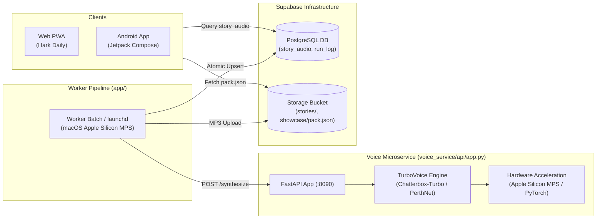

# 🎙️ Hark Daily — API Documentation

This document provides a comprehensive technical reference for the Hark Daily API surface area, covering the **Chatterbox-Turbo Voice Service (FastAPI)** and the **Storage & Data Access Protocols (Supabase)**.

---

## 1. System Architecture & Entry Points



* **Voice Microservice Entry Point**: [`voice_service/api/app.py`](file:///Users/vattitude/Coding/Morning_Brief/voice_service/api/app.py)
* **Default Host & Port**: `http://127.0.0.1:8090` (Local Apple Silicon M3 Pro)
* **Framework**: FastAPI (Python 3.11/3.12) with Uvicorn ASGI server
* **Concurrency Model**: Endpoints are defined as synchronous `def` functions so FastAPI dispatches model execution to threadpools, ensuring the async event loop is never blocked by CPU/GPU inference.

---

## 2. Authentication, Security & CORS

* **Authentication**: The Voice Service is an internal microservice designed to run inside a private VPC or over localhost. It requires no authentication token.
* **CORS**: Configured via the `VOICE_CORS_ORIGINS` environment variable (defaults to `*` for development).
  * Allowed Methods: `GET`, `POST`, `OPTIONS`
  * Allowed Headers: `*`
  * Exposed Headers: `X-Duration`, `X-Voice`, `X-Sample-Rate`, `X-Format`

---

## 3. Voice Service Endpoints

### 3.1. `GET /health`
Returns the operational health, active compute device, loaded model state, sample rate, and available reference voices.

#### Request
* **Method**: `GET`
* **Path**: `/health`
* **Headers**: `Accept: application/json`

#### Response (`200 OK`)
```json
{
  "status": "ok",
  "device": "mps",
  "sample_rate": 24000,
  "loaded": true,
  "default_voice": "c3po_reference.wav",
  "clips": 4
}
```

| Field | Type | Description |
| :--- | :--- | :--- |
| `status` | `string` | `"ok"` if default voice is available; `"no-default-voice"` otherwise. |
| `device` | `string` | Target compute hardware (`"cuda"`, `"mps"`, or `"cpu"`). |
| `sample_rate` | `integer` | Output sample rate in Hz (`24000`). |
| `loaded` | `boolean` | `true` if model weights are pre-warmed in memory; `false` if lazy-load pending. |
| `default_voice` | `string` or `null` | Filename of the primary reference clip. |
| `clips` | `integer` | Count of reference audio files detected in `VOICE_DIR`. |

#### Code Examples

**cURL**:
```bash
curl -X GET http://127.0.0.1:8090/health
```

**Python**:
```python
import httpx

response = httpx.get("http://127.0.0.1:8090/health", timeout=10.0)
print(response.json())
```

---

### 3.2. `GET /voices`
Lists all available voice reference clips located on disk (`data/voices/`), their durations, and whether they meet minimum requirements.

#### Request
* **Method**: `GET`
* **Path**: `/voices`
* **Headers**: `Accept: application/json`

#### Response (`200 OK`)
```json
{
  "dir": "/Users/vattitude/Coding/Morning_Brief/voice_service/data/voices",
  "default": "c3po_reference.wav",
  "clips": [
    {
      "name": "c3po_reference",
      "file": "c3po_reference.wav",
      "seconds": 29.84,
      "usable": true
    },
    {
      "name": "matthew_reference",
      "file": "matthew_reference.wav",
      "seconds": 7.49,
      "usable": true
    },
    {
      "name": "kelly_reference",
      "file": "kelly_reference.wav",
      "seconds": 6.13,
      "usable": true
    }
  ]
}
```

| Field | Type | Description |
| :--- | :--- | :--- |
| `clips[].name` | `string` | Voice identifier passed into `/synthesize`. |
| `clips[].seconds` | `number` | Duration of reference audio in seconds. |
| `clips[].usable` | `boolean` | Must be `true` (`duration > 5.0s`) for neural cloning to function. |

#### Code Examples

**cURL**:
```bash
curl -X GET http://127.0.0.1:8090/voices
```

**JavaScript (Fetch)**:
```javascript
const res = await fetch("http://127.0.0.1:8090/voices");
const data = await res.json();
console.log("Available voices:", data.clips.map(c => c.name));
```

---

### 3.3. `POST /synthesize`
Synthesizes a broadcast script into neural audio cloned from the requested persona. Returns raw binary audio (`audio/wav` or `audio/mpeg`).

#### Request
* **Method**: `POST`
* **Path**: `/synthesize`
* **Query Parameters**:
  * `format` (*optional*, string, default: `"wav"`): Choose `"wav"` (uncompressed 16-bit PCM) or `"mp3"` (compressed CBR audio).
* **Headers**:
  * `Content-Type: application/json`
  * `Accept: audio/mpeg, audio/wav`
* **Body Schema (`SynthRequest`)**:

```json
{
  "text": "Regular exercise does more than strengthen the heart. [[pause:0.5]] New research reveals it actually rewires cardiac nerves.",
  "voice": "c3po_reference",
  "beat": 0.3
}
```

| Parameter | Type | Required | Description |
| :--- | :--- | :--- | :--- |
| `text` | `string` | **Yes** | Broadcast script. Supports inline tags such as `[[pause:0.5]]` and `...`. Min length: 1. |
| `voice` | `string` | No | Identifier matching a `name` from `GET /voices`. Defaults to `reference.wav`. |
| `beat` | `number` | No | Default pause duration in seconds applied to ellipses (`...`). Value between `0.0` and `5.0`. |

#### Response (`200 OK`)
* **Content-Type**: `audio/wav` or `audio/mpeg`
* **Response Headers**:
  * `X-Sample-Rate`: `24000`
  * `X-Duration`: Audio length in seconds (e.g. `21.40`)
  * `X-Voice`: Filename of the cloned voice reference (e.g. `c3po_reference.wav`)
  * `X-Format`: Active format (`wav` or `mp3`)
* **Body**: Raw binary audio stream.

#### Error Responses

| Status Code | Reason | Body Schema | Troubleshooting |
| :--- | :--- | :--- | :--- |
| **400 Bad Request** | Unknown voice or empty text | `{"detail": "Unknown voice 'invalid_name'"}` | Ensure `voice` exists in `GET /voices` and `text` is non-empty. |
| **422 Unprocessable** | Schema validation failure | `{"detail": [{"loc": ["body", "beat"], ...}]}` | Verify `beat` is between `0.0` and `5.0`. |
| **503 Service Unavailable** | Model inference or encoder failure | `{"detail": "CUDA out of memory"}` | GPU memory exhausted or audio device disconnected. |

#### Code Examples

**cURL (MP3 output)**:
```bash
curl -X POST "http://127.0.0.1:8090/synthesize?format=mp3" \
  -H "Content-Type: application/json" \
  -d '{"text": "Good morning. Here are the top stories.", "voice": "c3po_reference"}' \
  --output story.mp3
```

**Python (httpx)**:
```python
import httpx

payload = {
    "text": "Good morning. Here is the latest in science.",
    "voice": "matthew_reference"
}
with httpx.Client(timeout=120.0) as client:
    resp = client.post("http://127.0.0.1:8090/synthesize?format=mp3", json=payload)
    resp.raise_for_status()
    duration = float(resp.headers.get("X-Duration", 0.0))
    print(f"Synthesized {duration:.1f}s of audio")
    with open("story.mp3", "wb") as f:
        f.write(resp.content)
```

---

### 3.4. `POST /news/sample`
Renders a structured sample bulletin with synchronized span timings for interactive audio players and landing page demonstrations.

#### Request
* **Method**: `POST`
* **Path**: `/news/sample`
* **Headers**: `Content-Type: application/json`
* **Body Schema (`SampleRequest`)**:

```json
{
  "text": "Good morning! [[pause:0.4]] Here is your news bulletin.",
  "voice": "c3po_reference",
  "beat": 0.3
}
```

*(If `text` is omitted, the service falls back to its built-in sample story.)*

#### Response (`200 OK`)
```json
{
  "voice": "c3po_reference.wav",
  "sample_rate": 24000,
  "duration": 4.82,
  "spans": 2,
  "marks": [
    {
      "text": "Good morning!",
      "start": 0.0,
      "end": 1.45
    },
    {
      "text": "Here is your news bulletin.",
      "start": 1.85,
      "end": 4.82
    }
  ],
  "text": "Good morning! Here is your news bulletin.",
  "warnings": [],
  "audio_b64": "UklGRi4AAABXQVZFZm10IBAAAAAB..."
}
```

| Field | Type | Description |
| :--- | :--- | :--- |
| `voice` | `string` | Name of the reference voice clip used. |
| `duration` | `number` | Total duration of the audio in seconds. |
| `marks` | `array` | Word/phrase alignment spans with start and end timestamps. |
| `text` | `string` | Cleaned script text stripped of pause tags. |
| `warnings` | `array[string]` | Informational warnings (e.g. unrecognized speech tags). |
| `audio_b64` | `string` | Complete WAV audio encoded in Base64 for instant browser decoding. |

#### Code Examples

**cURL**:
```bash
curl -X POST http://127.0.0.1:8090/news/sample \
  -H "Content-Type: application/json" \
  -d '{"voice": "matthew_reference"}'
```

---

## 4. Supabase Storage & Data Layer Protocols

Hark Daily publishes atomic briefing packs to Supabase. Web and mobile clients interact with the published briefings via Supabase's PostgREST and Storage APIs:

### 4.1. Public Showcase Manifest (`showcase/pack.json`)
* **URL**: `https://<PROJECT_REF>.supabase.co/storage/v1/object/public/briefings/showcase/pack.json`
* **Access**: Public / Unauthenticated
* **Description**: Assembled timeline of the day's briefing, containing audio URLs, chapter titles, section breakdowns, and pre-calculated clip offsets.

### 4.2. Authenticated Story Audio Table (`story_audio`)
* **Endpoint**: `GET /rest/v1/story_audio?date=eq.{YYYY-MM-DD}&voice=eq.{VOICE}&order=section.asc,rank.asc`
* **Schema**:
  * `date` (`text`): Briefing date in ISO format (`YYYY-MM-DD`).
  * `section` (`text`): Category (`top`, `ai`, `tech`, `politics`, `entertainment`, `science`, `sports`).
  * `rank` (`integer`): Story ranking within the section (`1` to `5`).
  * `voice` (`text`): Reference voice ID (`c3po_reference`, `matthew_reference`, `kelly_reference`, or custom neural persona).
  * `title` (`text`): Clean news headline.
  * `url` (`text`): Original article canonical URL.
  * `source` (`text`): Publisher attribution (e.g., `"ScienceDaily · Science"`).
  * `image` (`text`): Hero image URL extracted from the article.
  * `script` (`text`): Spoken text voiced by the neural model.
  * `duration` (`real`): Clip audio duration in seconds.
  * `audio_path` (`text`): Content-hashed storage path (`stories/{day}/{section}-{rank}-{voice}-{hash}.mp3`).

### 4.3. Podcast Banter Table (`podcast_clips`)
* **Endpoint**: `GET /rest/v1/podcast_clips?date=eq.{YYYY-MM-DD}&hosts=eq.{HOSTS}&select=*`
* **Schema**:
  * `date` (`text`): Briefing date in ISO format (`YYYY-MM-DD`).
  * `hosts` (`text`): Duo host identifiers (`matthew_reference+kelly_reference`).
  * `clip_key` (`text`): Banter piece identifier (`pod_open_1..3`, `pod_tease_<section>`, `pod_bridge_<section>`, `pod_close_1..2`, `podcast_ready`).
  * `text` (`text`): Spoken dialogue transcript.
  * `duration` (`real`): Clip audio duration in seconds.
  * `audio_path` (`text`): Storage path (`podcast/{date}/{clip_key}-{hosts}.mp3`).
  * `writer` (`text`): AI model attribution (`gemini-2.5-flash`, `openai/gpt-oss-120b`, or `built-in`).

---

## 5. Client Integration Quickstart

### Node.js / Browser Client
```javascript
import { createClient } from '@supabase/supabase-js';

const supabase = createClient('https://<REF>.supabase.co', '<ANON_KEY>');

// 1. Fetch today's public briefing pack
const { data: pack } = await supabase.storage
  .from('briefings')
  .download('showcase/pack.json');
const manifest = JSON.parse(await pack.text());

console.log(`Briefing for ${manifest.date}: ${manifest.rows.length} stories available`);
```

### Running the Voice Service Locally
```bash
# 1. Activate virtual environment
cd voice_service
source .venv/bin/activate

# 2. Start Uvicorn ASGI server
uvicorn api.app:app --host 127.0.0.1 --port 8090 --reload
```
