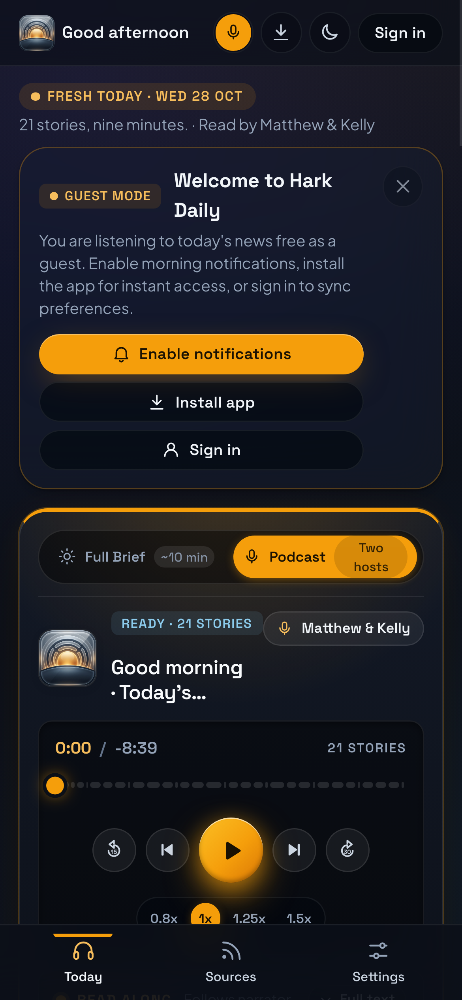

<div align="center">


# 🎙️ Hark Daily

**The news you hear, not just read.**  
A concise daily audio briefing covering **Canada**, the **United States**, and **India** from **CBC News**, **The New York Times**, **NPR**, **The Hindu**, **The Indian Express**, **TechCrunch**, **ScienceDaily**, and **ESPNcricinfo**, voiced by neural personas anchored by flagship narrator **C-3PO** alongside modular neural voices.  
No ads. Fast audio briefings. Zero doom-scrolling. 24-hour listening.

[](https://hark.vattitude.ca)
[](https://github.com/vattitude-me/Hark-Daily/releases/tag/android-v1.0.2)
[](voice_service/)
[](CHANGELOG.md)
[](web/privacy.html)

[**Web PWA**](#-web-pwa) · [**Android App**](#-android-app) · [**Features**](#-features) · [**Privacy**](web/privacy.html) · [**Terms**](web/terms.html) · [**Changelog**](CHANGELOG.md) · [**Technical Guide**](docs/TECHNICAL.md)

</div>

---

## ☕ Features

* **Multi-Country Editions (🇨🇦 Canada, 🇺🇸 US, 🇮🇳 India)**: Verified regional reporting coupled with shared global tech and science:
  * 🇨🇦 **Canada** — CBC News (Top, Politics, Arts, Sports) & BetaKit (Tech).
  * 🇺🇸 **United States** — The New York Times (Top), NPR Politics, Variety (Entertainment), CBS Sports.
  * 🇮🇳 **India** — The Hindu (Top/National), The Indian Express (Politics, Arts), ESPNcricinfo (Cricket/Sports).
  * 🌐 **Global Universals** — TechCrunch (AI), BetaKit/Verge (Tech), ScienceDaily (Science). Voiced once and shared across all countries.
* **Instant Edition Switcher**: Auto-detects local edition from the user's timezone with a 0ms topbar switcher (`🇨🇦 CA ▾`, `🇺🇸 US ▾`, `🇮🇳 IN ▾`) and fallback resilience.
* **Time-Neutral 24-Hour Listening**: Clean, day-neutral broadcast scripts and podcast banter. Listen at 7:00 AM, 3:00 PM, or 10:00 PM without hearing time-locked "Good morning" or "morning coffee" phrases.
* **Deep-Link Story Sharing**: Share any story card via Web Share API or direct link (`?story={section}-{rank}&date={YYYY-MM-DD}`). Receivers land directly on the shared audio clip even if it falls outside their default lineup.
* **Neural Voices**: Voiced by C-3PO alongside co-hosts Matthew & Kelly via local Chatterbox-Turbo TTS on Apple Silicon MPS.
* **Instant Playback**: Listen immediately on the web at [hark.vattitude.ca](https://hark.vattitude.ca) without sign-up.
* **Two Listening Modes**:
  * **Podcast (Default)** — Duo-host conversation with Matthew & Kelly tailored to your selected topics, with natural cadence, pauses, and broadcast titles.
  * **Full Brief** — Continuous radio-style narration across all chosen stories.
* **Two-Tier Timezone Scheduling**:
  * **Morning Batch (~6:00 AM EDT)**: Synthesizes Canada & US local sections + universal AI, Tech, Science.
  * **Evening Batch (~6:00 PM EDT / 3:30 AM IST)**: Synthesizes India local sections ahead of Indian morning wake-up (~6:00 AM IST) while reusing today's universal AI, Tech, and Science audio.
* **Privacy-Respecting Analytics**: Optional Google Analytics 4 integration with a lightweight cookie consent banner (Accept / Reject) for tracking story reach, shared link visits, and edition engagement without tracking across sites or advertising.
* **Cached Static Audio**: Reusable intros and sign-offs are stored permanently in Supabase, saving synthesis time on each batch.
* **Read-Along Teleprompter**: Subtitles and story cards follow the narrator in real time. Tap any card to seek to it.
* **Pull-to-Refresh**: Native pull gesture on Android to check for fresh editions on demand.
* **Custom Lineup**: Reorder topics and toggle categories to build your personal lineup.
* **Local Apple Silicon Synthesis**: Runs locally on macOS with PyTorch Metal Performance Shaders (MPS) and automated `launchd` scheduling. Zero cloud GPU costs.
* **No Ads or Sponsored Feeds**: No sponsored stories, third-party advertising, or algorithmic feeds.

---

## 🖥️ Web PWA

Works in modern browsers on desktop, tablet, and mobile with light and dark themes, background playback, and zero forced login.

<div align="center">

### Desktop View (Today's Briefing & Podcast Player)


### Mobile PWA (Dark & Light)
<p align="center">
  
  
</p>

</div>

Install as a Progressive Web App (PWA) on Chrome, Edge, or Safari for offline caching, background playback, and web push notifications.

---

## 📱 Android App

Native Android application built with Jetpack Compose, Compose Material3 tokens, and Media3 background audio.

<div align="center">

| Active Playback (Dark) | Today's Briefing | Topics & Sources | Settings & Voices |
| :---: | :---: | :---: | :---: |
|  |  |  |  |

</div>

- **Pull-Down-to-Refresh**: Smooth native pull gesture to refresh stories and audio packs on demand.
- **Background Playback**: Android Media3 notification and lock-screen playback controls with scrubber.
- **Narrator Switcher**: Instant switching between active voice personas without losing playback position.
- **Custom Category Sorting**: Prioritize and toggle categories according to your morning routine.
- **Device & Cloud Playback**: Stream cloud-voiced editions or run on-device audio offline.

---

## 🚀 Getting Started

### Web
1. Open the live web app at [**hark.vattitude.ca**](https://hark.vattitude.ca) (or local [web/](web/)).
2. Click **Play** on today’s edition—no account or sign-up required.
3. Switch your country edition anytime via the topbar flag chip (`🇨🇦 CA`, `🇺🇸 US`, `🇮🇳 IN`).
4. Tap the voice chips in the player to audition and switch narrators on the fly.
5. Sign in with Google or magic link if you wish to sync custom topic preferences across devices.

### Android
1. Download the latest signed APK from [GitHub Releases](https://github.com/vattitude-me/Hark-Daily/releases).
2. Install on any device running Android 10+ (API 29+).
3. Select your preferred country edition and voice narrator in Settings, then start listening.

### Command-Line CLI Operations
```bash
# Set up Python virtual environment
python3 -m venv .venv
source .venv/bin/activate
pip install -r requirements.txt

# Voice today's briefing pack for specific country editions
python -m app pack --edition ca,us       # Morning batch (Canada + US)
python -m app pack --edition in          # Evening batch (India morning peak)
python -m app pack --edition ca,us,in    # All three editions simultaneously

# Check completeness of today's pack across all voices
python -m app pack --check

# Dry-run / showcase landing sample only
python -m app pack --showcase-only
```

---

## 🛠️ Developer Documentation

- [**Technical & Architecture Guide (`docs/TECHNICAL.md`)**](docs/TECHNICAL.md) — Architecture diagrams, Supabase schema, Apple Silicon MPS pipeline, and dual-edition power relay.
- [**Automated Daily Pack Run Guide (`docs/nightly.md`)**](docs/nightly.md) — macOS launchd automation, sleep/wake power management, and manual CLI operations.
- [**Android App Guide (`android/README.md`)**](android/README.md) — Gradle build steps, Compose architecture, and release signing.
- [**Voice Service Guide (`voice_service/README.md`)**](voice_service/README.md) — Chatterbox-Turbo TTS service, FastAPI endpoints, GPU acceleration, and voice reference clips.
- [**Privacy Policy (`web/privacy.html`)**](web/privacy.html) — Clear statement on data minimization and privacy.
- [**Terms of Use (`web/terms.html`)**](web/terms.html) — Fair dealing and source attribution terms.
- [**Changelog (`CHANGELOG.md`)**](CHANGELOG.md) — Version history and release notes.

---

<div align="center">

Free · Open Source · No ads · Privacy First

</div>
