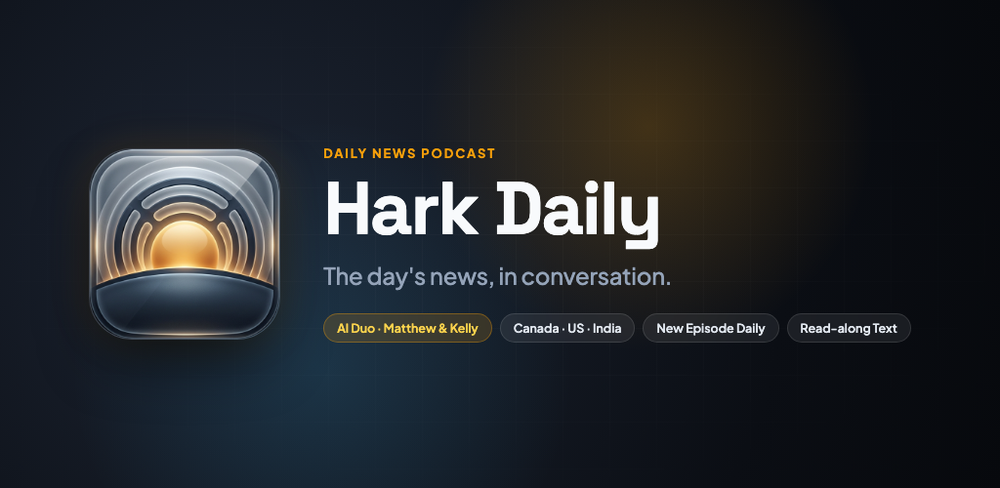
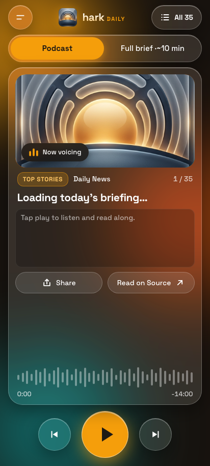
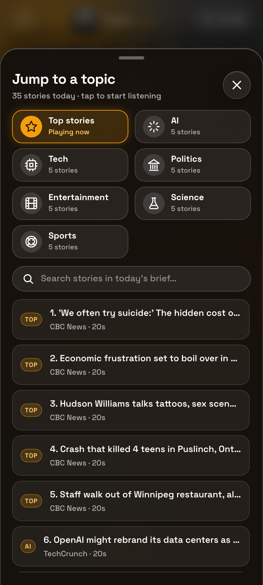
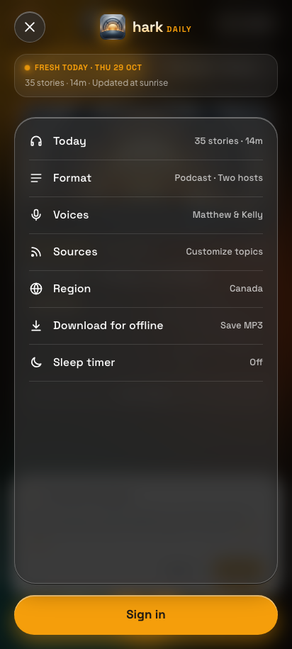

<div align="center">



# Hark Daily

**The day's news, in conversation.**

A short daily news podcast for Canada, the US and India. Two AI hosts, Matthew and Kelly, talk you through the day's stories.

No ads. No sign-up. Open it and press play.

[](https://hark.vattitude.ca)
[](https://github.com/vattitude-me/Hark-Daily/releases)
[](CHANGELOG.md)

</div>

<p align="center">
  
  
  
</p>

## What you get

- A new episode every morning, with up to 8 sections: top stories, markets, AI, tech, politics, entertainment, science and sports.
- Three editions. Canada, the US and India each use local sources. AI and science stories are shared by all three.
- Podcast mode, where two hosts talk through the news. Full Brief mode, where one narrator reads each story.
- Pick your topics, their order and how many stories each one gets.
- Read-along text that highlights as it plays. Tap a sentence to jump to it.
- The last 7 days of episodes.
- Share links that open straight to one story.
- Optional Google sign-in to sync your settings across devices.

## Sources

| Edition | Sources |
| :--- | :--- |
| Canada | CBC News, CBC Business, BetaKit |
| US | The New York Times, MarketWatch, The Verge, NPR, Variety, CBS Sports |
| India | The Hindu, Economic Times, Indian Express, ESPNcricinfo |
| All editions | TechCrunch (AI), ScienceDaily (science) |

## Use it

- **Web.** Open [hark.vattitude.ca](https://hark.vattitude.ca). You can add it to your home screen.
- **Android.** Get the APK from [Releases](https://github.com/vattitude-me/Hark-Daily/releases). Needs Android 7.0 or later.
- **iOS.** Build from Xcode for now. See [ios/README.md](ios/README.md).

## How it works

A Mac builds each day's episode early in the morning. It reads RSS feeds, writes short scripts, voices them with a local text-to-speech model, and uploads the MP3s to Supabase. The web app and the Android and iOS apps all run the same code in [`web/`](web/). They download the clips and put the briefing together on your device, based on your topics.

More detail is in [docs/TECHNICAL.md](docs/TECHNICAL.md).

## Develop

Web and mobile apps:

```bash
npm install
npm test                     # web app tests
npm run sync                 # copy web/ into the Android and iOS projects
npm run build:android        # release APK
npx cap open ios             # open in Xcode
```

Backend:

```bash
python3 -m venv .venv && source .venv/bin/activate
pip install -r requirements.txt
cp .env.example .env         # add your Supabase and LLM keys
python -m app pack --check   # show what today's pack has
python -m app pack --edition ca,us,in
pytest
```

The voice service has its own setup. See [voice_service/README.md](voice_service/README.md).

## Docs

- [Technical guide](docs/TECHNICAL.md)
- [Daily run on macOS](docs/nightly.md)
- [Voice service](voice_service/README.md)
- [Android app](android/README.md)
- [iOS app](ios/README.md)
- [API reference](API_DOCUMENTATION.md)
- [Changelog](CHANGELOG.md)
- [Privacy](web/privacy.html) and [terms](web/terms.html)
