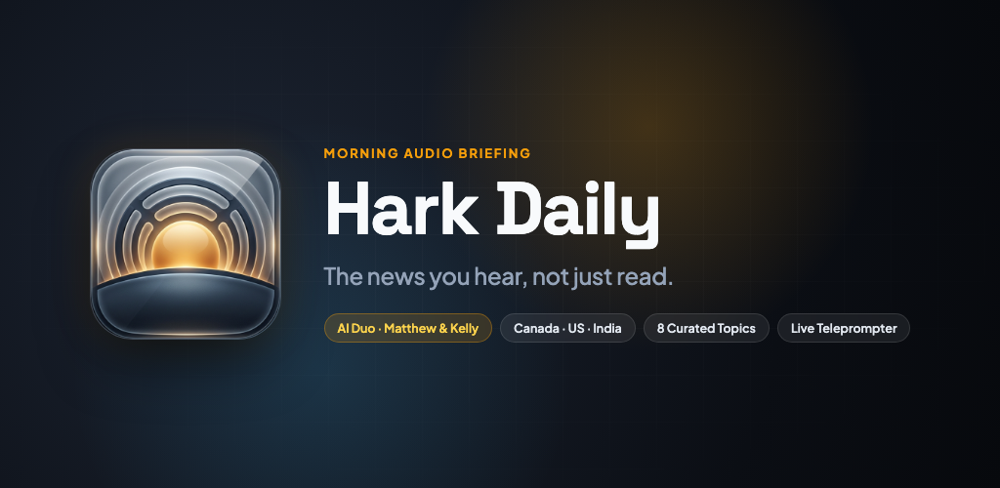
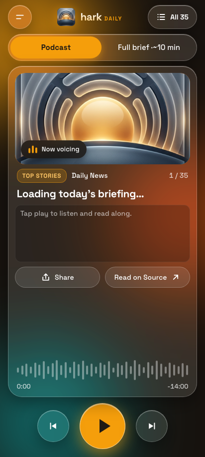
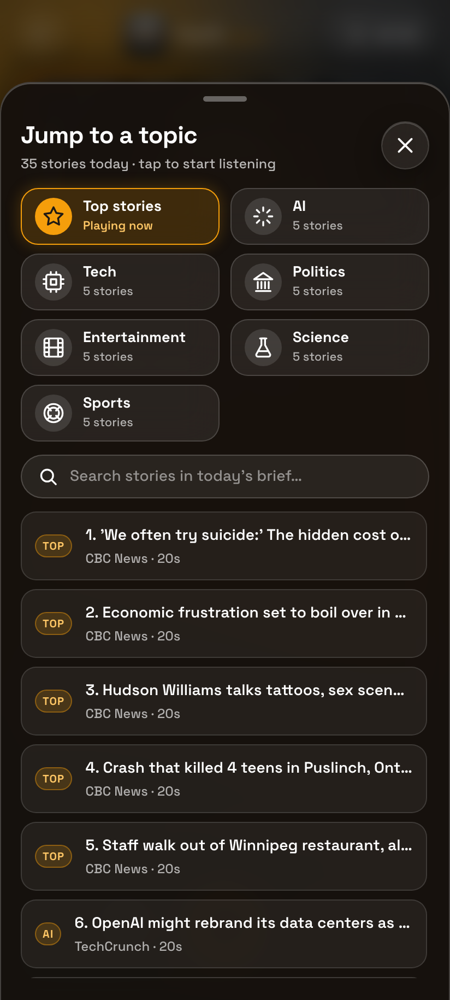
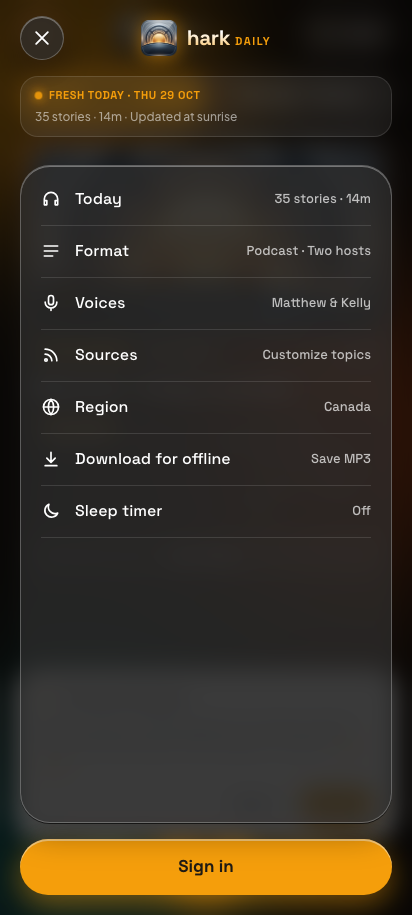
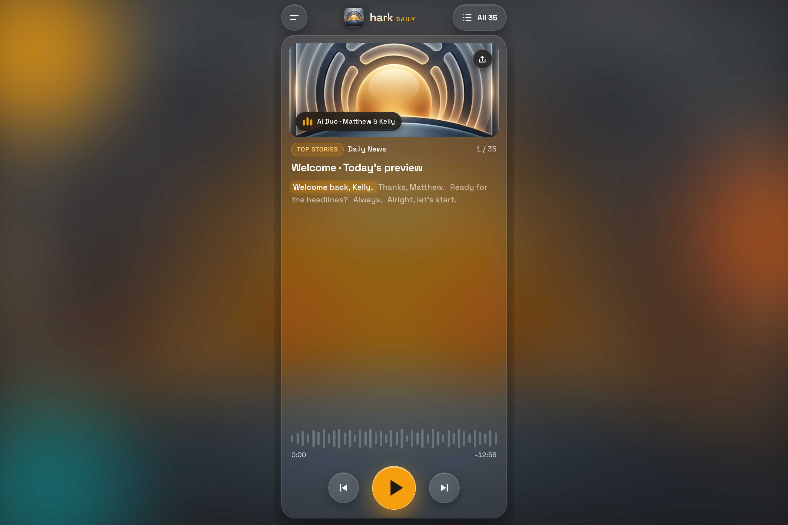
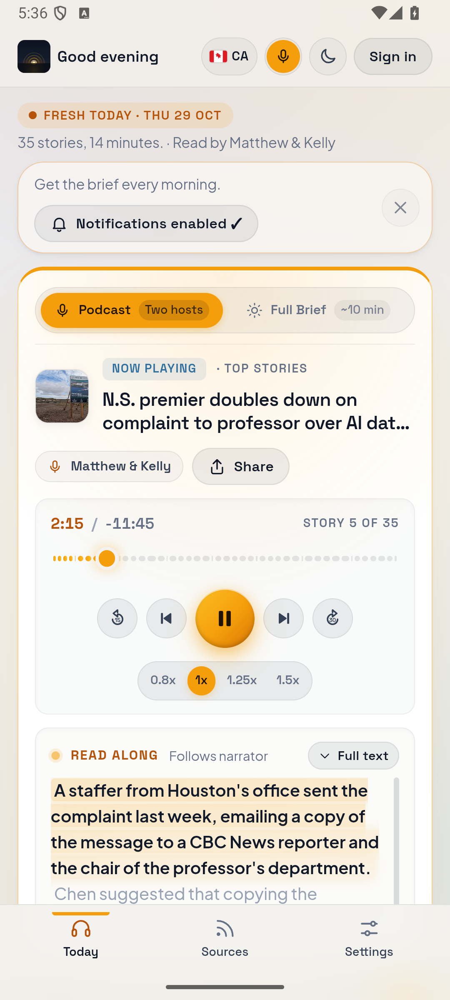
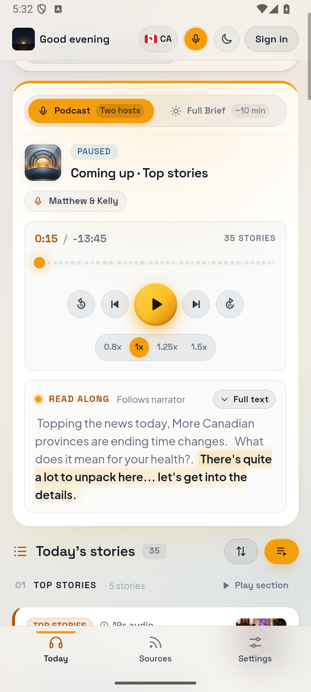
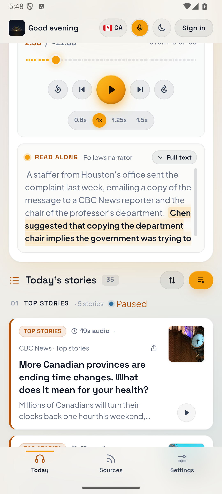
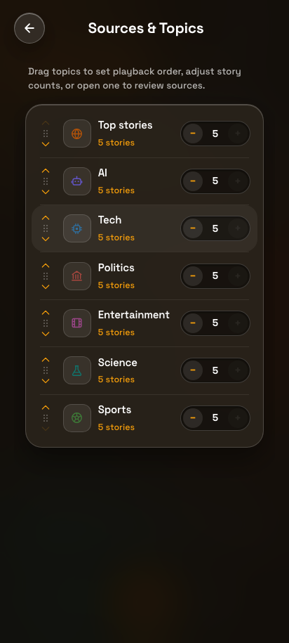

<div align="center">



# 🎙️ Hark Daily

**The news you hear, not just read.**  
A concise daily audio briefing covering **Canada**, the **United States**, and **India** from **CBC News**, **The New York Times**, **NPR**, **The Hindu**, **The Indian Express**, **TechCrunch**, **ScienceDaily**, and **ESPNcricinfo**. Voiced by a duo-host neural podcast team (Matthew & Kelly) alongside solo narrator personas.  
No ads. Fast audio briefings. Zero doom-scrolling. 24-hour listening.

[](https://hark.vattitude.ca)
[](https://github.com/vattitude-me/Hark-Daily/releases)
[](ios/README.md)
[](capacitor.config.json)
[](voice_service/)
[](CHANGELOG.md)
[](web/privacy.html)

[**Cross-Platform Apps**](#-cross-platform-apps-web-pwa-android--ios) · [**Features**](#-features) · [**Getting Started**](#-getting-started) · [**Building Mobile Shells**](#-building-mobile-shells-with-capacitor) · [**Privacy**](web/privacy.html) · [**Terms**](web/terms.html) · [**Changelog**](CHANGELOG.md) · [**Technical Guide**](docs/TECHNICAL.md)

</div>

---

## ☕ Features

* **Duo-Host AI Podcast (Default)**: Matthew & Kelly break down the day's stories in a natural two-host dialogue. Host 1 introduces the headline and context; Host 2 adds the angle, implication, and takeaway. Natural banter, section teases, and zero canned laughs.
* **Full Brief Mode**: Prefer a solo news anchor? Switch to continuous radio-style narration voiced by C-3PO or chosen neural personas.
* **Multi-Country Editions (🇨🇦 Canada, 🇺🇸 US, 🇮🇳 India)**:
  * 🇨🇦 **Canada** — CBC News (Top, Politics, Arts, Sports) & BetaKit (Tech).
  * 🇺🇸 **United States** — The New York Times (Top), NPR Politics, Variety (Entertainment), CBS Sports.
  * 🇮🇳 **India** — The Hindu (Top/National), The Indian Express (Politics, Arts), ESPNcricinfo (Cricket/Sports).
  * 🌐 **Global Universals** — TechCrunch (AI), BetaKit/Verge (Tech), ScienceDaily (Science). Voiced once and shared across all editions.
* **Pull-Down-to-Refresh**: Tactile pull gesture across Web PWA, Android, and iOS to check for updated audio packs and fresh editions on demand.
* **Pinned Player Bar**: 40-bar acoustic waveform scrubber and media transport stay locked to the viewport on any screen size, orientation change, or virtual keyboard shift.
* **Read-Along Teleprompter**: Spoken text highlights in real time with host badges (Matthew in amber, Kelly in teal). Tap any sentence to seek directly to that moment.
* **Time-Neutral 24-Hour Listening**: Broadcast scripts avoid time-locked morning phrases. Listen at 7:00 AM, 2:00 PM, or 11:00 PM without hearing stale morning greetings.
* **Instant Edition Switcher**: Auto-detects local edition from timezone with a 0ms topbar switcher (`🇨🇦 CA`, `🇺🇸 US`, `🇮🇳 IN`).
* **Deep-Link Story Sharing**: Share any story card via direct link (`?story={section}-{rank}&date={YYYY-MM-DD}`). Receivers land directly on the shared audio clip.
* **Two-Tier Daily Synthesis**:
  * **Morning Batch (~6:00 AM EDT)**: Synthesizes Canada & US local sections + universal AI, Tech, Science.
  * **Evening Batch (~6:00 PM EDT / 3:30 AM IST)**: Synthesizes India local sections ahead of Indian morning commute while reusing today's universal AI, Tech, and Science audio.
* **Local Apple Silicon Synthesis**: Runs on macOS via PyTorch Metal Performance Shaders (MPS) and automated `launchd` scheduling. Zero cloud GPU costs.
* **Zero Accounts, Zero Ads**: Open [hark.vattitude.ca](https://hark.vattitude.ca) and hit play. No sign-up required, no paywalls, and no sponsored feeds.

---

## 📱 Cross-Platform Apps (Web PWA, Android & iOS)

Hark Daily is built as a unified cross-platform application powered by **[Capacitor](https://capacitorjs.com/)**. A single, responsive web core ([`web/`](web/)) drives the **Web PWA**, **Android Smart Native Shell**, and **iOS Smart Native Shell**, providing 100% feature parity, shared state, and instant over-the-air updates.

```
                            ┌───────────────────────────────┐
                            │    Hark Daily Web Core        │
                            │  (HTML5 / CSS / ES Modules)   │
                            └──────────────┬────────────────┘
                                           │
                        ┌──────────────────┼──────────────────┐
                        │                  │                  │
                        ▼                  ▼                  ▼
               ┌────────────────┐  ┌────────────────┐  ┌────────────────┐
               │    Web PWA     │  │  Android Shell │  │   iOS Shell    │
               │ (Chrome/Safari)│  │  (Capacitor)   │  │  (Capacitor)   │
               ├────────────────┤  ├────────────────┤  ├────────────────┤
               │ • Offline SW   │  │ • Foreground   │  │ • AVAudio-     │
               │ • Web Push     │  │   MediaService │  │   Session Spoken│
               │ • Zero Install │  │ • Wake Lock    │  │ • Dynamic Island│
               │ • MediaSession │  │ • Keep-Screen  │  │ • CarPlay /     │
               │   API          │  │ • Play Store   │  │   Control Center│
               └────────────────┘  └────────────────┘  └────────────────┘
```

### 1. Web Progressive Web App (PWA)
* **Zero Barrier**: Open [**hark.vattitude.ca**](https://hark.vattitude.ca) in Chrome, Safari, Edge, or Firefox and start listening immediately.
* **Offline Shell**: Fully cached via Service Worker (`hark-daily-v88`) for instant loading on any network condition.
* **Installable**: Add to Home Screen on mobile or install as a desktop PWA with media key support.

<div align="center">

<p align="center">
  
  
  
</p>

#### Desktop Responsive View


</div>

### 2. Android Smart Native Shell ([`android/`](android/README.md))
* **Unbroken Background Playback**: Native `HarkMediaService` runs as an Android Foreground Service with type `mediaPlayback` and CPU `PARTIAL_WAKE_LOCK`, ensuring playback never pauses when the screen turns off.
* **System Lockscreen & Notification Scrubber**: Synchronizes with Android `MediaSessionCompat` for notification controls, lock screen art, and Bluetooth/Android Auto metadata.
* **Hardware Keep-Screen-On**: Automatically holds `FLAG_KEEP_SCREEN_ON` during active playback so users can read along with the spoken teleprompter without the display dimming.
* **Branded Notifications**: Custom notification channels (`hark_daily_briefing`) with high-priority wakeup for daily edition drops.

<div align="center">

| Active Playback | Today's Briefing | Story Feed | Topics & Sources |
| :---: | :---: | :---: | :---: |
|  |  |  |  |

</div>

### 3. iOS Smart Native Shell ([`ios/`](ios/README.md))
* **Background Audio Session**: `AVAudioSession` configured with `.playback` category and `.spokenAudio` mode in `AppDelegate.swift` for seamless background audio.
* **Now Playing & Dynamic Island**: Integrates with iOS Control Center, Lock Screen scrubber, Dynamic Island, and CarPlay transports via standard Web `MediaSession` bridge.
* **Universal Deep Links**: Registered custom scheme `me.vattitude.morningbrief://` and associated domain `hark.vattitude.ca` for direct one-tap story loading.
* **Edge-to-Edge Dark Theme**: Hardware safe-area inset management with native `#0d0d0d` background.

---

## 🚀 Getting Started

### Web
1. Open the live web app at [**hark.vattitude.ca**](https://hark.vattitude.ca).
2. Click **Play** on today’s edition—no account or sign-up required.
3. Switch your country edition anytime via the topbar flag chip (`🇨🇦 CA`, `🇺🇸 US`, `🇮🇳 IN`).
4. Pull down anytime on mobile to refresh today's briefing.

### Android
1. Download the latest signed APK from [**GitHub Releases**](https://github.com/vattitude-me/Hark-Daily/releases).
2. Install on any device running Android 10+ (API 29+).
3. Select your edition and start listening.

### iOS
1. Open [`ios/App/App.xcodeproj`](ios/App/App.xcodeproj) in Xcode 15+.
2. Select your development team and build directly to an iPhone or iOS Simulator.

---

## 📱 Building Mobile Shells with Capacitor

Hark Daily uses Capacitor CLI to sync web assets to native Android and iOS wrapper projects:

```bash
# 1. Install project dependencies
npm install

# 2. Sync web build and native plugins to both Android and iOS
npm run sync
# or directly: npx cap sync

# --------------------------------------------------------------------
# Android Builds
# --------------------------------------------------------------------
# Build debug or release APKs via Gradle wrapper
npm run build:android:debug
npm run build:android

# Build Google Play release App Bundle (AAB)
npm run build:android:bundle

# Open Android Studio
npx cap open android

# --------------------------------------------------------------------
# iOS Builds
# --------------------------------------------------------------------
# Build release archive via xcodebuild
npm run build:ios

# Open in Xcode
npx cap open ios
```

---

## ⚙️ Backend & Synthesis CLI Operations

The daily briefing pipeline compiles news feeds and voices audio locally on Apple Silicon:

```bash
# Set up Python virtual environment
python3 -m venv .venv
source .venv/bin/activate
pip install -r requirements.txt

# Voice today's briefing pack for specific country editions
python -m app pack --edition ca,us       # Morning batch (Canada + US)
python -m app pack --edition in          # Evening batch (India morning peak)
python -m app pack --edition ca,us,in    # All three editions simultaneously

# Check completeness of today's pack across all voices
python -m app pack --check

# Dry-run / showcase landing sample only
python -m app pack --showcase-only
```

---

## 🛠️ Developer Documentation

- [**Technical & Architecture Guide (`docs/TECHNICAL.md`)**](docs/TECHNICAL.md) — Architecture diagrams, Supabase schema, Apple Silicon MPS pipeline, and dual-edition power relay.
- [**Android App Guide (`android/README.md`)**](android/README.md) — Gradle build steps, Foreground MediaService architecture, and release signing.
- [**iOS App Guide (`ios/README.md`)**](ios/README.md) — Xcode project configuration, AVAudioSession background audio, and universal links.
- [**Automated Daily Pack Run Guide (`docs/nightly.md`)**](docs/nightly.md) — macOS launchd automation, sleep/wake power management, and manual CLI operations.
- [**Voice Service Guide (`voice_service/README.md`)**](voice_service/README.md) — Chatterbox-Turbo TTS service, FastAPI endpoints, GPU acceleration, and voice reference clips.
- [**Archived v1.0 Legacy Assets (`docs/archive/v1.0/README.md`)**](docs/archive/v1.0/README.md) — Historical mockups, legacy planning documents, and superseded media.
- [**Privacy Policy (`web/privacy.html`)**](web/privacy.html) — Clear statement on data minimization and privacy.
- [**Terms of Use (`web/terms.html`)**](web/terms.html) — Fair dealing and source attribution terms.
- [**Changelog (`CHANGELOG.md`)**](CHANGELOG.md) — Version history and release notes.

---

<div align="center">

Free · Open Source · No ads · Privacy First

</div>
