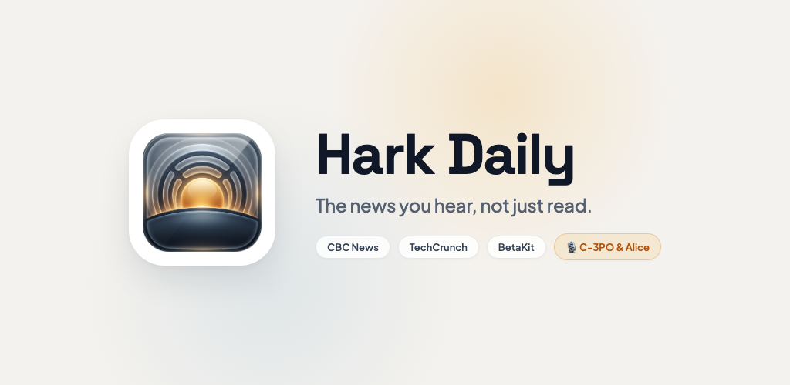
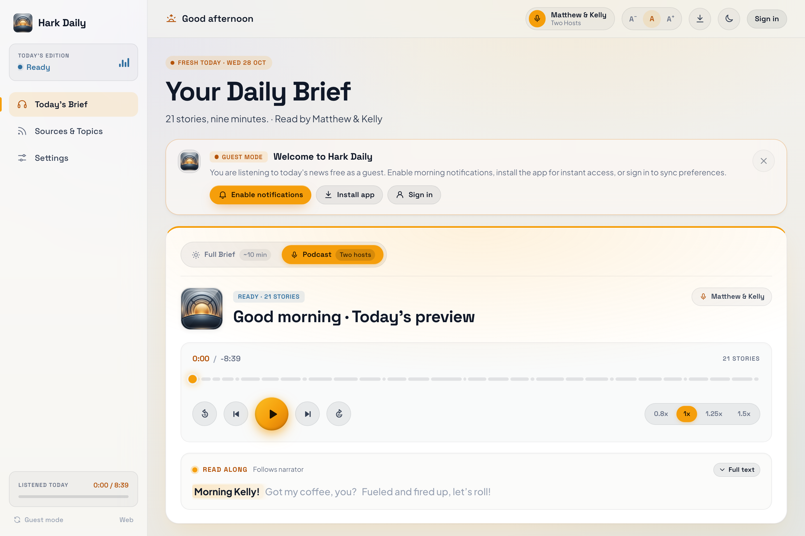
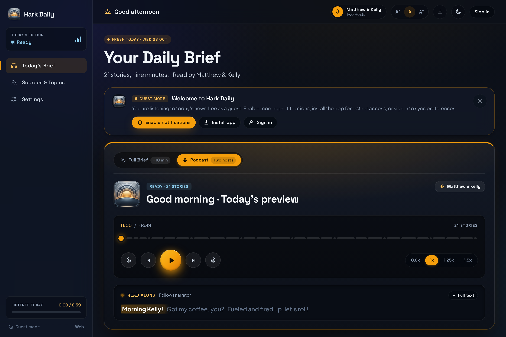
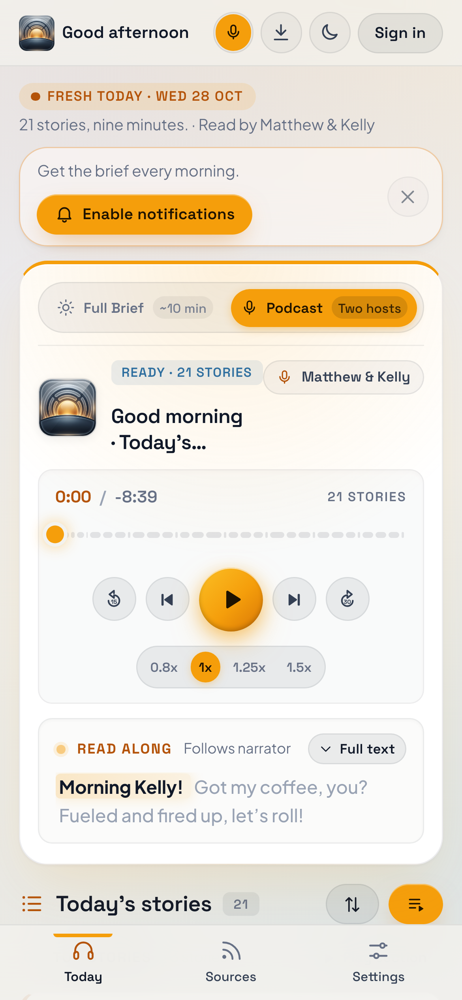
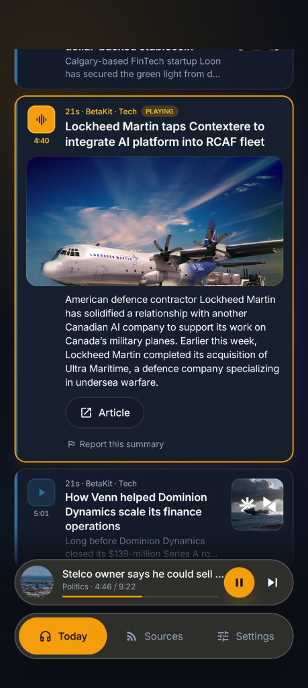

# 🎙️ Hark Daily

**The news you hear, not just read.**  
A concise daily audio briefing from **CBC News**, **TechCrunch**, **ScienceDaily**, and **BetaKit**, voiced by neural personas anchored by flagship narrator **C-3PO** alongside modular neural voices.  
No ads. No tracking. Zero doom-scrolling.

[**Web PWA**](#-web-pwa) · [**Android App**](#-android-app) · [**Features**](#-features) · [**Privacy**](web/privacy.html) · [**Terms**](web/terms.html) · [**Changelog**](CHANGELOG.md) · [**Technical Guide**](docs/TECHNICAL.md)

---

## ☕ Features

* **Multi-Provider News Architecture**: Curated stories across 7 focused sections:
  * **CBC News** — Canadian & world Top Stories, Politics, Entertainment, and Sports.
  * **ScienceDaily** — Cutting-edge research, health breakthroughs, space, and discoveries (CBC News fallback).
  * **TechCrunch** — Deep dive into Artificial Intelligence and machine intelligence.
  * **BetaKit** — Canadian tech, startup ecosystems, and venture innovation.
* **Neural Voice Personas & Modular Architecture**:
  * Anchored by permanent flagship narrator **C-3PO** alongside a modular, rotating roster of neural personas across conversational, broadcast, and character delivery styles.
  * **Interactive Live Demo**: Audition all active narrators and switch voices seamlessly in the live web player at [**hark.vattitude.ca**](https://hark.vattitude.ca)—no sign-up required.
* **Dual Listening Modes**:
  * **Full Briefing** — Immersive radio-style listening with spoken section intros and dynamic greetings.
  * **Podcast** (feature-flagged) — The same news with two hosts chatting around it, adapting to the topics you follow.
* **Time-Adaptive Audio**: Adapts greetings (`Good morning`, `Good afternoon`, `Good evening`) to your local timezone.
* **Permanent Static Notes Architecture**: Greetings, section transitions, and sign-offs are voiced once and stored in a permanent static repository (`notes/static/`), verified before GPU shutdown to ensure $0 recurring compute costs.
* **Interactive Follow-Along**: Story cards highlight and auto-scroll in sync with the audio. Tap any story card to seek directly to it.
* **Pull-Down-to-Refresh**: Native Android gesture on `TodayScreen` to instantly re-check for the latest stories and audio updates.
* **Custom Topic Ordering**: Drag and reorder topics to prioritize the sections you care about first.
* **Cost-Efficient Cloud Infrastructure**: Fully automated Google Cloud Run orchestration that starts on-demand GCE L4 GPU VMs for batch synthesis and terminates them immediately to prevent idle cloud billing.
* **Strict Privacy by Design**: No sponsored stories, no advertising networks, no tracking pixels, and no algorithmic rabbit holes.

---

## 🖥️ Web PWA

Works in any modern browser on desktop, tablet, and mobile with automatic light and dark themes.

### Desktop View (Light & Dark)

### Mobile Web PWA

Install as a Progressive Web App (PWA) on Chrome, Edge, or Safari for offline caching, background playback, and web push notifications.

---

## 📱 Android App

Native Android application built with Jetpack Compose, Compose Material3 tokens, and Media3 background audio.

| Today's Briefing | Follow-Along Audio | Topics & Sources | Settings & Voices |
| :---: | :---: | :---: | :---: |
|  |  |  |  |

- **Pull-Down-to-Refresh**: Smooth native pull gesture to refresh stories and audio packs on demand.
- **Background Playback**: Android Media3 notification and lock-screen playback controls with scrubber.
- **Narrator Switcher**: Instant switching between active voice personas without losing playback position.
- **Custom Category Sorting**: Prioritize and toggle categories according to your morning routine.
- **Device & Cloud Playback**: Stream cloud-voiced editions or run on-device audio offline.

---

## 🚀 Getting Started

### Web
1. Open the live web app at [**hark.vattitude.ca**](https://hark.vattitude.ca) (or local [web/](web/)).
2. Click **Play** on today’s edition—no account or sign-up required.
3. Tap the voice chips in the player to audition and switch narrators on the fly.
4. Sign in with Google or magic link if you wish to sync custom topic preferences across devices.

### Android
1. Download the latest signed APK from [GitHub Releases](https://github.com/vattitude-me/Hark-Daily/releases).
2. Install on any device running Android 10+ (API 29+).
3. Select your preferred voice narrator in Settings and start listening.

---

## 🛠️ Developer Documentation

- [**Technical & Architecture Guide (`docs/TECHNICAL.md`)**](docs/TECHNICAL.md) — Architecture diagrams, Supabase schema, Cloud Run jobs, and GCE GPU automation.
- [**Android App Guide (`android/README.md`)**](android/README.md) — Gradle build steps, Compose architecture, and release signing.
- [**Voice Service Guide (`voice_service/README.md`)**](voice_service/README.md) — Chatterbox-Turbo TTS service, FastAPI endpoints, GPU acceleration, and voice reference clips.
- [**Privacy Policy (`web/privacy.html`)**](web/privacy.html) — Clear statement on data minimization and privacy.
- [**Terms of Use (`web/terms.html`)**](web/terms.html) — Fair dealing and source attribution terms.
- [**Changelog (`CHANGELOG.md`)**](CHANGELOG.md) — Version history and release notes.

---

Free · Open Source · No ads · No tracking

