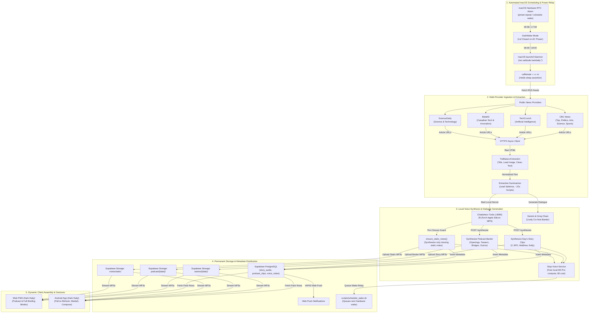

# Hark Daily — Technical & Architecture Guide

Hark Daily is an automated, multi-provider news briefing system that compiles, summarizes, and voices daily news into a 5-minute personalized audio briefing. Spoken audio is rendered on an Apple Silicon Mac using Metal Performance Shaders (MPS) hardware acceleration, framed with permanent static transitions and dynamic co-host banter, and assembled dynamically on client devices based on user topic preferences, category ordering, and listening mode (Podcast vs. Full Briefing).

---

## Architecture Flow

The system runs automated morning and evening batch ingestion and synthesis pipelines triggered by macOS `launchd`, writes shared audio clips and podcast dialogue to Supabase, and serves them to client applications.



---

## 1. Multi-Provider News Ingestion & Article Extraction

### Multi-Provider Architecture ([`app/topics.py`](file:///Users/vattitude/Coding/Morning_Brief/app/topics.py))
The system ingests stories across 7 canonical categories configured for **Canada (CA)**, the **United States (US)**, and **India (IN)**, while sharing global technology and science coverage universally across all regions:

#### 1. Universal Shared Sections (Voiced once globally, reused across all editions)
- `ai` — TechCrunch Artificial Intelligence (`https://techcrunch.com/category/artificial-intelligence/feed/`)
- `tech` — BetaKit Canadian Tech & Innovation / Ars Technica / The Verge
- `science` — ScienceDaily (`https://www.sciencedaily.com/rss/top/science.xml`, CBC News fallback)

#### 2. Regional Specific Sections
- 🇨🇦 **Canada (`ca`)**:
  - `top` — CBC News Top Stories (`https://www.cbc.ca/cmlink/rss-topstories`)
  - `politics` — CBC News Politics (`https://www.cbc.ca/cmlink/rss-politics`)
  - `entertainment` — CBC News Arts & Entertainment (`https://www.cbc.ca/cmlink/rss-arts`)
  - `sports` — CBC News Sports (`https://www.cbc.ca/cmlink/rss-sports`)
- 🇺🇸 **United States (`us`)**:
  - `top_us` — The New York Times (`https://rss.nytimes.com/services/xml/rss/nyt/HomePage.xml`)
  - `politics_us` — NPR Politics (`https://feeds.npr.org/1014/rss.xml`)
  - `entertainment_us` — Variety (`https://variety.com/feed/`)
  - `sports_us` — CBS Sports (`https://www.cbssports.com/rss/headlines/`)
- 🇮🇳 **India (`in`)**:
  - `top_in` — The Hindu National (`https://www.thehindu.com/news/national/feeder/default.rss`)
  - `politics_in` — The Indian Express Politics (`https://indianexpress.com/section/political-pulse/feed/`)
  - `entertainment_in` — The Indian Express Entertainment (`https://indianexpress.com/section/entertainment/feed/`)
  - `sports_in` — ESPNcricinfo (`https://www.espncricinfo.com/rss/content/story/feeds/0.xml`)

#### 3. Two-Tier Batch Scheduling & Compute Reuse
- **Morning Batch (~6:00 AM EDT)**: Runs `--edition ca,us`. Voices Canada and US regional sections, along with shared `ai`, `tech`, and `science`.
- **Evening Batch (~6:00 PM EDT = 3:30 AM IST)**: Runs `--edition in`. Targets morning commute in Mumbai and New Delhi (~6:00 AM IST). Voices India-specific local sections while automatically reusing today's already-voiced universal `ai`, `tech`, and `science` audio.

#### 4. Zero-Migration Database Model
All clips are stored in Supabase under `story_audio` with primary key `(date, section, rank, voice)`. Regional stories use section identifiers (`top_us`, `top_in`), while universal stories use canonical keys (`ai`, `tech`, `science`). This avoids database schema migrations and guarantees full backward compatibility for older clients.

The feed order reflects editorial curation. The worker selects the top 5 articles per category with deep deduplication buffers, editorial recency backfill, and cross-run continuity to guarantee sections never starve below the requested story count.

### Parsing with Trafilatura ([`app/fetcher.py`](file:///Users/vattitude/Coding/Morning_Brief/app/fetcher.py))
`trafilatura` extracts clean article text, metadata, and hero images from raw HTML while stripping out boilerplate, navigation menus, inline ads, and comments:

```python
def extract_article(page_html: str, url: str) -> dict:
    raw = trafilatura.extract(
        page_html,
        url=url,
        output_format="json",
        with_metadata=True,
        include_comments=False,
        include_tables=False,
        favor_precision=True,
    )
    if not raw:
        meta = trafilatura.extract_metadata(page_html, default_url=url)
        return {
            "title": getattr(meta, "title", None),
            "description": getattr(meta, "description", None),
            "image": getattr(meta, "image", None),
            "sitename": getattr(meta, "sitename", None),
            "text": "",
        }
    data = json.loads(raw)
    return {
        "title": data.get("title"),
        "description": data.get("description") or data.get("excerpt"),
        "image": data.get("image"),
        "sitename": data.get("sitename") or data.get("hostname"),
        "date": data.get("date"),
        "text": data.get("text") or data.get("raw_text") or "",
    }
```

### Extractive Summarization ([`app/summarizer.py`](file:///Users/vattitude/Coding/Morning_Brief/app/summarizer.py))
Spoken broadcast scripts are extracted algorithmically from original reporting:
1. Strips datelines, author credits, and photo captions.
2. Identifies key informational sentences using lead paragraph proximity and term frequency salience.
3. Produces a 2-to-3 sentence script calibrated to ~22 seconds of spoken broadcast.

---

## 2. Permanent Static Voice Notes Library & Pre-Closure Guard

Spoken framing consists of greetings, section introductions, and the briefing sign-off. Because these scripts are static and fixed, synthesizing them every single day is unnecessary.

### Static Asset Storage ([`app/storypack.py`](file:///Users/vattitude/Coding/Morning_Brief/app/storypack.py))
1. **Permanent Storage Path**:
   Spoken framing clips are stored permanently in Supabase Storage at:
   `notes/static/{note_key}-{voice}.mp3`
2. **Sentinel Date Indexing**:
   Static metadata rows are indexed in PostgreSQL under sentinel date `STATIC_DATE = "2000-01-01"`.
3. **11 Canonical Notes per Voice**:
   - 3 Time-adaptive greetings (`greeting_morning`, `greeting_afternoon`, `greeting_evening`)
   - 7 Section transitions (`intro_top`, `intro_ai`, `intro_tech`, `intro_politics`, `intro_entertainment`, `intro_science`, `intro_sports`)
   - 1 Sign-off (`outro`)

### Pre-Closure Guard (`ensure_static_notes`)
Before the daily batch completes and shuts down the local voice service:
- `ensure_static_notes()` checks if any static note is missing for the active voices.
- If all 11 static notes exist for that voice: **0 synthesis calls are made**.
- If a new voice is added or a note is missing: The pipeline synthesizes the missing notes and registers them permanently in `notes/static/`.
- `build_notes()` links the static storage paths into today's `voice_notes` rows for the current date, ensuring 100% transparent backwards compatibility with existing Android and Web client versions.

### Retention Protection (`prune_older`)
Automated database and storage cleanup routines in [`app/storypack.py:prune_older()`](file:///Users/vattitude/Coding/Morning_Brief/app/storypack.py#L134-L160) are guarded:
- Excludes `STATIC_DATE = "2000-01-01"` from table row pruning.
- Explicitly filters out all paths starting with `notes/static/` from `remove_objects()`, guaranteeing permanent static audio files are never purged.

---

## 3. Local Apple Silicon M3 Pro Voice Synthesis (Metal Performance Shaders)

Neural audio synthesis runs locally on the host Mac using **Apple Silicon Metal Performance Shaders (MPS)** hardware acceleration:

```text
Resource Profile (Local M3 Pro Apple Silicon):
- Hardware Acceleration:            Apple Silicon MPS (Metal Performance Shaders)
- Inference Engine:                 Chatterbox-Turbo (PerthNet / Kokoro)
- Generation Speed:                 ~3.5x to 4x real-time (an 8s clip takes ~2s)
- Total Synthesis Duration:         ~15 to 20 minutes per full edition (35 stories + 20 banter pieces)
- Recurring Cloud Compute Cost:     $0.00 / month (100% local hardware)
```

### Voice Service API Contracts ([`voice_service/api/app.py`](file:///Users/vattitude/Coding/Morning_Brief/voice_service/api/app.py))
The TTS service exposes endpoints on port `8090`:

#### `GET /health`
```json
{
  "status": "ok",
  "device": "mps",
  "sample_rate": 24000
}
```

#### `GET /voices`
Lists available voice reference clips in `voice_service/data/voices/`:
- `c3po_reference` — C-3PO (Polite protocol droid, flagship narrator)
- `matthew_reference` — Matthew (Calm American newsreader, podcast co-host)
- `kelly_reference` — Kelly (Engaging American newsreader, podcast co-host)

#### `POST /synthesize?format=mp3`
```http
POST /synthesize?format=mp3 HTTP/1.1
Content-Type: application/json

{
  "text": "Good morning. In artificial intelligence news today, researchers announced...",
  "voice": "c3po_reference"
}
```
Response:
```http
HTTP/1.1 200 OK
Content-Type: audio/mpeg
X-Duration: 21.84

<binary audio bytes>
```

---

## 4. Client Assembly & Dual Listening Modes

### Client Assembly Engine (`StoryPack`)
Audio clips are synthesized once globally for all listeners. The web PWA ([`web/js/storypack.js`](file:///Users/vattitude/Coding/Morning_Brief/web/js/storypack.js)) and Android app ([`StoryPack.kt`](file:///Users/vattitude/Coding/Morning_Brief/android/app/src/main/java/me/vattitude/morningbrief/data/StoryPack.kt)) assemble custom briefings client-side without re-encoding:

1. **Verify Readiness**: Checks that `voice_notes` contains a `pack_ready` marker for the requested voice and date.
2. **Greeting Selection**: Selects `greeting_morning` (< 12:00), `greeting_afternoon` (12:00–17:00), or `greeting_evening` (>= 17:00) according to the user's local clock.
3. **Listening Modes**:
   - **Podcast (Default)**: Dynamic co-host dialogue (Matthew & Kelly) bookending each section, adapting dynamically to the listener's topic selection.
   - **Full Briefing**: Traditional radio-style listening with individual story narration, spoken section introductions (`intro_{section}`), and sign-off.
4. **Category Ordering**: Sequences stories according to user's custom `section_order` (default: `top`, `ai`, `tech`, `politics`, `entertainment`, `science`, `sports`).
5. **Story Counts**: Selects the top $N$ stories configured for each category.
6. **Breaths**: Inserts a 0.8-second silent pause (`BREATH = 0.8`) between consecutive clips for natural broadcast pacing.

### Podcast Mode Architecture
Two co-hosts (**Matthew & Kelly**) converse around the news. Banter is generated by [`app/podcast.py`](file:///Users/vattitude/Coding/Morning_Brief/app/podcast.py) after the pack's stories and notes are published:

- **Banter Pieces**:
  - `pod_open_1..3`: Lively opening greetings previewing the day's stories.
  - `pod_tease_<section>`: Conversational reactions to that section's top story.
  - `pod_bridge_<section>`: Transition lead-ins into the section.
  - `pod_close_1..2`: Warm, conversational sign-offs.
  - Stored in `podcast_clips` with a `podcast_ready` marker.
- **Time-Neutral 24-Hour Listening**:
  - Banter prompts and writer templates are strictly time-neutral. Phrasing such as *"Good morning"*, *"morning coffee"*, *"morning brief"*, or *"see you tomorrow morning"* is prohibited.
  - Listeners opening the app in the afternoon, evening, or across varying timezones hear natural, time-agnostic announcements (*"Welcome to Hark Daily"*, *"Here is your briefing"*, *"That's today's briefing. Have a great day, and stay informed."*).
- **Clean Title & Artwork Decoupling**:
  - During intro banter and teasers, player headlines display clean broadcast title messages (`Welcome · Today's preview`, `Coming up · Top stories`, `Up next · Tech`, `That's today's brief · Signing off`) instead of raw spoken dialogue.
  - Displays the official Hark Daily podcast logo (`/icons/icon-512.png` or `ic_hark_logo`) during conversational segments, transitioning to editorial photography during news stories.
  - The bottom Read-Along visor continues to provide word-for-word transcript subtitles.
- **Expressive Dialogue & Inter-Turn Pauses**:
  - Dialogue generation uses Gemini/Groq LLMs with expressive prompts, natural contractions, and speech tags (`[chuckle]`, `[laugh]`, `[sigh]`, `[gasp]`).
  - Co-host turn transitions inject `[[pause:0.35]]` silence tokens so alternating speakers take natural conversational breaths rather than colliding.
  - Duo host badge formats cleanly as `Matthew & Kelly`.

---

## 5. Story Sharing & Deep-Linking Resolution

### Per-Story URL Routing
Every story card features a native Web Share / copy link trigger generating canonical deep links:
`https://hark.vattitude.ca/?story={section}-{rank}&date={YYYY-MM-DD}`

### Deep-Link Ingestion & Playback Guarantees
When a user opens a shared link:
1. **Target Story Extraction**: `web/js/app.js` parses the URL params (`targetStory`, `date`).
2. **Lineup Resilience**: If the targeted story rank exceeds the viewer's active section count (e.g. `top-4` when default is 3), the briefing assembler temporarily raises the wanted count for that section so the clip is guaranteed to be in the playlist.
3. **Edition Fallback**: If the shared link references an edition-specific story (e.g. `top_us-1`), the client loads and positions the player on that specific story without breaking the current user's session.
4. **Playback Positioning**: Automatically seeks and scrolls directly to the shared story card.

---

## 6. Privacy-Respecting Analytics (Google Analytics 4)

- **Measurement ID**: `G-8LV7D5TDT2`.
- **Consent Banner**: Lightweight, non-intrusive cookie consent banner presented on first visit.
  - **Accept**: Activates GA4 script tag and persists consent in `localStorage` (`hark_analytics_consent = 'granted'`).
  - **Decline**: Suppresses GA4 loading completely (`hark_analytics_consent = 'denied'`).
- **Tracked Custom Events**:
  - `share` — When a user shares a story card via Web Share API or clipboard.
  - `shared_link_open` — When a visitor lands on the site via a shared story deep-link.
  - `select_content` — When a user switches country editions (`ca`, `us`, `in`) or briefing modes.
  - `footer_link_click` — Outbound navigation to publisher domains or project links.
- **Data Minimization**: IP anonymization enabled by default; zero cross-site fingerprinting or advertising cookies.

---

## 5. Storage & Database Schema

Synthesized audio files are stored in Supabase Storage (`briefings` bucket) and tracked in PostgreSQL:

- **`story_audio`**: Individual story clips.
  - Columns: `date`, `section`, `rank`, `title`, `script`, `url`, `source`, `image`, `audio_path`, `duration`, `voice`.
- **`podcast_clips`**: Conversational banter pieces.
  - Columns: `date`, `hosts`, `clip_key`, `text`, `duration`, `audio_path`, `writer`.
- **`voice_notes`**: Spoken framing audio clips and status markers.
  - Columns: `date`, `voice`, `note_key`, `text`, `duration`, `audio_path`.
  - Permanent static rows: `date = "2000-01-01"`, `audio_path = "notes/static/{key}-{voice}.mp3"`.
  - Daily pointer rows: `date = "{YYYY-MM-DD}"`, pointing to the static audio paths.
  - Completion marker: `note_key = "pack_ready"`, `text = "{clips} clips, {notes} notes"`.
- **`profiles`**: User settings stored as JSONB (`stories`, `section_order`, `voice`, `speed`, `daily`, `color_photos`).

---

## 6. Environment Configuration

| Variable | Example Value | Description |
| :--- | :--- | :--- |
| `SUPABASE_URL` | `https://xyz.supabase.co` | Supabase API endpoint |
| `SUPABASE_SECRET_KEY` | `ey...` | Service-role key for backend worker write operations |
| `VOICE_SERVICE_URL` | `http://127.0.0.1:8090` | Local voice service endpoint |
| `VOICE_DIR` | `/.../voice_service/data/voices` | Directory of reference voice embeddings and audio samples |
| `STORY_VOICES` | `c3po_reference,matthew_reference,kelly_reference` | Voices rendered during daily batch |
| `PODCAST_ENABLED` | `true` | Generates podcast banter and enables Podcast mode |
| `PODCAST_HOSTS` | `matthew_reference,kelly_reference` | Duo host voice IDs |
| `BRIEFING_TIMEZONE` | `America/Toronto` | Primary timezone for schedule calculations |
| `VAPID_PRIVATE_KEY` | `...` | Private key for Web Push delivery |
| `VAPID_PUBLIC_KEY` | `...` | Public key distributed to clients for push subscription |

---

## 7. Operations & Automation CLI

### macOS Automated Batch Runners
* **Morning Edition (06:00 AM)**:
  ```bash
  ./scripts/morning_pack_mac.sh
  ```
* **Evening Edition (18:00 PM)**:
  ```bash
  ./scripts/evening_pack_mac.sh
  ```
* **Podcast Banter Regeneration**:
  ```bash
  ./scripts/podcast_pack_mac.sh --force
  ```
* **Hardware Wake Schedule Status**:
  ```bash
  ./scripts/schedule_wake.sh status
  ```

---

## 8. Testing

### Python Backend Unit Tests
```bash
pytest -q
```

### Android Unit Tests
```bash
cd android
./gradlew testDebugUnitTest
```
