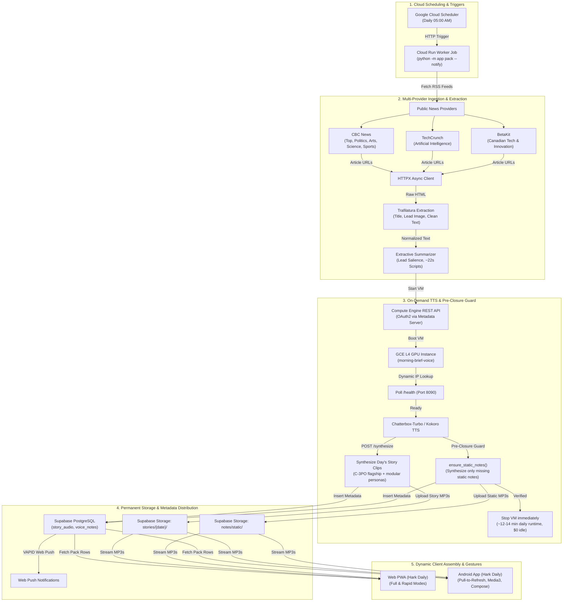

# Hark Daily — Technical & Architecture Guide

Hark Daily is an automated, multi-provider news briefing system that compiles, summarizes, and voices daily news into a 5-minute personalized audio briefing. Spoken audio is rendered once per day on an on-demand GPU instance, framed with permanent static transitions, and assembled dynamically by web and Android clients based on user topic preferences, category ordering, and listening mode (Full vs. Rapid).

---

## Architecture Flow

The system runs a daily batch ingestion and synthesis pipeline triggered by Google Cloud Scheduler, writes shared audio clips and static framing to Supabase, and serves them to client applications.



---

## 1. Multi-Provider News Ingestion & Article Extraction

### Multi-Provider Architecture ([`app/topics.py`](file:///Users/vattitude/Coding/Morning_Brief/app/topics.py))
The system ingests stories across 7 editorial categories configured with reputable Canadian and international tech news feeds:
- `top` — CBC News Top Stories (`https://www.cbc.ca/cmlink/rss-topstories`)
- `ai` — TechCrunch Artificial Intelligence (`https://techcrunch.com/category/artificial-intelligence/feed/`)
- `tech` — BetaKit Canadian Tech & Innovation (`https://betakit.com/feed/`)
- `politics` — CBC News Politics (`https://www.cbc.ca/cmlink/rss-politics`)
- `entertainment` — CBC News Arts & Entertainment (`https://www.cbc.ca/cmlink/rss-arts`)
- `science` — ScienceDaily (`https://www.sciencedaily.com/rss/top/science.xml`, CBC News fallback)
- `sports` — CBC News Sports (`https://www.cbc.ca/cmlink/rss-sports`)

The feed order reflects editorial curation. The worker selects the top 5 articles per category with deep deduplication buffers, editorial recency backfill, and cross-run continuity to guarantee sections never starve below the requested story count.

### Parsing with Trafilatura ([`app/fetcher.py`](file:///Users/vattitude/Coding/Morning_Brief/app/fetcher.py))
`trafilatura` extracts clean article text, metadata, and hero images from raw HTML while stripping out boilerplate, navigation menus, inline ads, and comments:

```python
def extract_article(page_html: str, url: str) -> dict:
    raw = trafilatura.extract(
        page_html,
        url=url,
        output_format="json",
        with_metadata=True,
        include_comments=False,
        include_tables=False,
        favor_precision=True,
    )
    if not raw:
        meta = trafilatura.extract_metadata(page_html, default_url=url)
        return {
            "title": getattr(meta, "title", None),
            "description": getattr(meta, "description", None),
            "image": getattr(meta, "image", None),
            "sitename": getattr(meta, "sitename", None),
            "text": "",
        }
    data = json.loads(raw)
    return {
        "title": data.get("title"),
        "description": data.get("description") or data.get("excerpt"),
        "image": data.get("image"),
        "sitename": data.get("sitename") or data.get("hostname"),
        "date": data.get("date"),
        "text": data.get("text") or data.get("raw_text") or "",
    }
```

### Extractive Summarization ([`app/summarizer.py`](file:///Users/vattitude/Coding/Morning_Brief/app/summarizer.py))
Spoken broadcast scripts are extracted algorithmically from original reporting:
1. Strips datelines, author credits, and photo captions.
2. Identifies key informational sentences using lead paragraph proximity and term frequency salience.
3. Produces a 2-to-3 sentence script calibrated to ~22 seconds of spoken broadcast.

---

## 2. Permanent Static Voice Notes Library & Pre-Closure Guard

Spoken framing consists of greetings, section introductions, and the briefing sign-off. Because these scripts are static and fixed, synthesizing them every single day was redundant and incurred avoidable GPU costs.

### Static Asset Storage ([`app/storypack.py`](file:///Users/vattitude/Coding/Morning_Brief/app/storypack.py))
1. **Permanent Storage Path**:
   Spoken framing clips are stored permanently in Supabase Storage at:
   `notes/static/{note_key}-{voice}.mp3`
2. **Sentinel Date Indexing**:
   Static metadata rows are indexed in PostgreSQL under sentinel date `STATIC_DATE = "2000-01-01"`.
3. **11 Canonical Notes per Voice**:
   - 3 Time-adaptive greetings (`greeting_morning`, `greeting_afternoon`, `greeting_evening`)
   - 7 Section transitions (`intro_top`, `intro_ai`, `intro_tech`, `intro_politics`, `intro_entertainment`, `intro_science`, `intro_sports`)
   - 1 Sign-off (`outro`)

### Pre-Closure Guard (`ensure_static_notes`)
Before the daily batch completes and shuts down the GPU VM:
- `ensure_static_notes()` checks if any static note is missing for the active voices.
- If all 11 static notes exist for that voice: **0 GPU calls are made** (100% compute savings).
- If a new voice is added (e.g. adding a custom narrator) or a note is missing: The pipeline synthesizes the missing notes using the active VM session and registers them permanently in `notes/static/` before shutting down the instance.
- `build_notes()` links the static storage paths into today's `voice_notes` rows for the current date, ensuring 100% transparent backwards compatibility with existing Android and Web client versions.

### Retention Protection (`prune_older`)
Automated database and storage cleanup routines in [`app/storypack.py:prune_older()`](file:///Users/vattitude/Coding/Morning_Brief/app/storypack.py#L134-L160) are guarded:
- Excludes `STATIC_DATE = "2000-01-01"` from table row pruning.
- Explicitly filters out all paths starting with `notes/static/` from `remove_objects()`, guaranteeing permanent static audio files are never purged.

---

## 3. On-Demand TTS & GCE GPU Lifecycle

Neural audio synthesis runs on an NVIDIA L4 GPU instance (`morning-brief-voice`). To eliminate the high cost of a 24/7 VM (~$600/month), [`app/gce.py`](file:///Users/vattitude/Coding/Morning_Brief/app/gce.py) manages the instance lifecycle dynamically via Compute Engine REST APIs:

```text
Monthly Cost Profile (active voices: C-3PO flagship + modular neural personas):
- 24/7 GCE L4 GPU:                  ~$600.00 / month
- 1-hour static daily cron:          ~$26.00 / month
- Dynamic on-demand lifecycle:         ~$9.80 / month (~$0.32 / day total)
    • GPU Compute (~12 min/day @ $0.84/hr): ~$0.17 / day (~$5.10 / mo)
    • 40 GB Boot Disk (pd-balanced):        ~$0.13 / day ($4.00 / mo)
    • Artifact Registry image storage:      ~$0.02 / day ($0.70 / mo)
    • Static Framing Notes:                 $0.00 (reused permanently from notes/static/)
    • Ephemeral External IP:                $0.00 (allocated on boot, released on stop)
```

### Dynamic VM Session Flow
[`app/gce.py:voice_vm_session`](file:///Users/vattitude/Coding/Morning_Brief/app/gce.py#L182-L287) handles authentication, boot, IP resolution, health checks, and verified shutdown in a Python context manager:

1. **Authentication**: Requests an OAuth2 access token via Google Cloud internal metadata server (`http://metadata.google.internal/computeMetadata/v1/instance/service-accounts/default/token`) in Cloud Run, or falls back to `gcloud auth print-access-token` locally.
2. **Fail-Fast Error Handling**: Immediately raises `VoiceServiceDown` if the instance returns HTTP 404 (deleted/not found) or 403 (unauthorized), avoiding 180s polling retry loops.
3. **Ephemeral Dynamic IP Resolution**: When the instance starts, GCE allocates an ephemeral external IP. The session loop queries `https://compute.googleapis.com/compute/v1/projects/{project}/zones/{zone}/instances/{instance}` to read the instance's active `natIP`. Using an ephemeral IP avoids GCP's idle reservation fees when the VM is powered down.
4. **Health Check**: Polls `GET http://<VM_IP>:8090/health` up to 180 seconds until the FastAPI service responds with `{"status": "ok"}`.
5. **Synthesis & Pre-Closure Check**: Synthesizes the day's story scripts, verifies all static framing notes exist, and sets the `pack_ready` status.
6. **Automatic Teardown**: An outer `finally` block unconditionally calls `stop_vm_verified()` once audio generation completes (or on error), which automatically transitions the VM to `TERMINATED` and releases the ephemeral IP.

### Voice Service API Contracts
The TTS service in [`voice_service/`](file:///Users/vattitude/Coding/Morning_Brief/voice_service) exposes three endpoints on port `8090`:

#### `GET /health`
```json
{
  "status": "ok",
  "device": "cuda",
  "sample_rate": 24000
}
```

#### `GET /voices`
Lists available voice reference clips in `voice_service/data/voices/`:
- `c3po_reference` — C-3PO (Polite protocol droid, permanent flagship anchor)
- `matthew_reference` — Matthew (Calm American newsreader, modular neural narrator)
- `kelly_reference` — Kelly (Engaging American newsreader, modular neural narrator)

#### `POST /synthesize?format=mp3`
```http
POST /synthesize?format=mp3 HTTP/1.1
Content-Type: application/json

{
  "text": "Good morning. In artificial intelligence news today, researchers announced...",
  "voice": "c3po_reference"
}
```
Response:
```http
HTTP/1.1 200 OK
Content-Type: audio/mpeg
X-Duration: 21.84

<binary audio bytes>
```

---

## 4. Client Assembly & Dual Listening Modes

### Client Assembly Engine (`StoryPack`)
Audio clips are synthesized once globally for all listeners. The web PWA ([`web/js/storypack.js`](file:///Users/vattitude/Coding/Morning_Brief/web/js/storypack.js)) and Android app ([`StoryPack.kt`](file:///Users/vattitude/Coding/Morning_Brief/android/app/src/main/java/me/vattitude/morningbrief/data/StoryPack.kt)) assemble custom briefings client-side without re-encoding:

1. **Verify Readiness**: Checks that `voice_notes` contains a `pack_ready` marker for the requested voice and date.
2. **Greeting Selection**: Selects `greeting_morning` (< 12:00), `greeting_afternoon` (12:00–17:00), or `greeting_evening` (>= 17:00) according to the user's local clock.
3. **Dual Listening Modes**:
   - **Full Briefing**: Plays the time greeting, followed by spoken section introductions (`intro_{section}`) before each section's first story, concluding with the `outro`.
   - **Rapid Briefing** (hidden: `FEATURES.rapid = false` in `web/config.js`; code kept): Omits category intros to deliver a swift, continuous headline flow with zero conversational interruptions.
   - **Podcast**: Same stories, with two hosts chatting around them (see *Podcast Mode* below). Falls back to the Full Briefing when the day has no usable podcast.
4. **Category Ordering**: Sequences stories according to user's custom `section_order` (default: `top`, `ai`, `tech`, `politics`, `entertainment`, `science`, `sports`).
5. **Story Counts**: Selects the top $N$ stories configured for each category.
6. **Breaths**: Inserts a 0.8-second silent pause (`BREATH = 0.8`) between consecutive clips for natural broadcast pacing.

### Podcast Mode (feature-flagged)
Two hosts (`PODCAST_HOSTS`, default Matthew and Kelly; any two voice ids) chat around the news. The stories are still read by the listener's narrator. Banter is generated by [`app/podcast.py`](../app/podcast.py) after the pack's stories and notes are published, in an isolated step: if it fails, the brief is unaffected.

- **Pieces, shared by everyone**: `pod_open_1..3` (greeting chat, no news), `pod_tease_<section>` (reaction to that section's #1 story), `pod_bridge_<section>` (lead-in), `pod_close_1..2`. Stored in `podcast_clips` with a `podcast_ready` marker.
- **Dynamic lineup**: the client (`planPodcast` in `storypack.js`) picks an opening and closing variant by date, then adds teasers (first 3 sections) and bridges while they fit a 90 s banter budget, so a 3-category lineup gets a short chat and a 7-category one doesn't get a long one. Missing pieces are skipped.
- **Writer**: one AI call per day (Gemini then Groq models, same keys as story copy), each piece validated (speakers, turn and word caps, no URLs/markdown); invalid pieces or an AI outage use built-in template dialogue.
- **Toggles**: server `PODCAST_ENABLED` (nothing is generated; the worker publishes `podcast.enabled` in `app_status`, so the UI hides the mode on its next load) and front-end `FEATURES.podcast` in `web/config.js`. Both must be on.
- **Fallbacks**: flag off, no ready marker, or no opening/closing means the Full Briefing plays (with a notice if the listener had chosen Podcast).

### Android Native App & Gestures ([`TodayScreen.kt`](file:///Users/vattitude/Coding/Morning_Brief/android/app/src/main/java/me/vattitude/morningbrief/ui/TodayScreen.kt))
- **Pull-Down-to-Refresh**: Wrapped in Material3 `PullToRefreshBox` styled with app tokens (`containerColor = t.cardBg`, `color = t.ink`). Users can pull down on `TodayScreen` to re-fetch stories and audio packs on demand without blanking the active UI.
- **Background Playback**: Android Media3 notification and lock-screen playback controls with scrubber.
- **Narrator Switcher**: Instant switching between active voice personas without losing playback position.

---

## 5. Storage & Database Schema

Synthesized audio files are stored in Supabase Storage (`briefings` bucket) and tracked in PostgreSQL:

- **`story_audio`**: Individual story clips.
  - Columns: `date`, `section`, `rank`, `title`, `script`, `url`, `source`, `image`, `audio_path`, `duration`, `voice`.
- **`voice_notes`**: Spoken framing audio clips and status markers.
  - Columns: `date`, `voice`, `note_key`, `text`, `duration`, `audio_path`.
  - Permanent static rows: `date = "2000-01-01"`, `audio_path = "notes/static/{key}-{voice}.mp3"`.
  - Daily pointer rows: `date = "{YYYY-MM-DD}"`, pointing to the static audio paths.
  - Completion marker: `note_key = "pack_ready"`, `text = "{clips} clips, {notes} notes"`.
- **`profiles`**: User settings stored as JSONB (`stories`, `section_order`, `voice`, `speed`, `daily`, `color_photos`).

---

## 6. Environment Configuration

| Variable | Example Value | Description |
| :--- | :--- | :--- |
| `SUPABASE_URL` | `https://xyz.supabase.co` | Supabase API endpoint |
| `SUPABASE_SECRET_KEY` | `ey...` | Service-role key for backend worker write operations |
| `VOICE_SERVICE_URL` | `http://34.67.158.112:8090` | Primary voice service endpoint (or `auto` for dynamic IP) |
| `GCP_PROJECT` | `project-67937e0a-4d2d-43ea-9ba` | Google Cloud project ID |
| `GCE_ZONE` | `us-central1-c` | Zone containing the GPU VM |
| `GCE_INSTANCE` | `morning-brief-voice` | Compute Engine VM instance name |
| `GCE_MANAGE_VM` | `true` | Enables automatic VM boot, dynamic IP resolution, and shutdown |
| `STORY_VOICES` | `c3po_reference,matthew_reference,kelly_reference` | Comma-separated voices to render during daily batch (C-3PO flagship, modular neural narrators) |
| `PODCAST_ENABLED` | `false` | Generates podcast banter and shows the Podcast mode (server-side kill switch) |
| `PODCAST_HOSTS` | `matthew_reference,kelly_reference` | The two voice ids that host the podcast; the first speaks first |
| `BRIEFING_TIMEZONE` | `America/Toronto` | Primary timezone for schedule calculations |
| `VAPID_PRIVATE_KEY` | `...` | Key for Web Push delivery |
| `VAPID_PUBLIC_KEY` | `...` | Public key distributed to clients for push subscription |

---

## 7. Operations & CLI Commands

### Run Story Pack Generation Locally
```bash
# Build daily pack for all configured voices
python3 -m app pack

# Build for a specific voice and date
python3 -m app pack --date 2026-10-24 --voice c3po_reference

# Verify environment, database connections, and static voice notes
python3 -m app check
```

### Trigger Batch with On-Demand GPU VM
```bash
./scripts/daily_pack_run.sh
```

### Deploy Cloud Run Scheduled Job & Worker Image
```bash
# Builds worker image via Cloud Build and deploys Cloud Run Jobs
./scripts/setup-scheduler.sh project-67937e0a-4d2d-43ea-9ba us-central1
```

### Complete Teardown of GCE Resources (To Eliminate All GCP Costs)
```bash
./scripts/teardown-gce.sh project-67937e0a-4d2d-43ea-9ba us-central1-c morning-brief-voice
```

---

## 8. Testing

### Python Backend Unit Tests
```bash
pytest -q
```

### Android Unit Tests
```bash
cd android
./gradlew testDebugUnitTest
```

