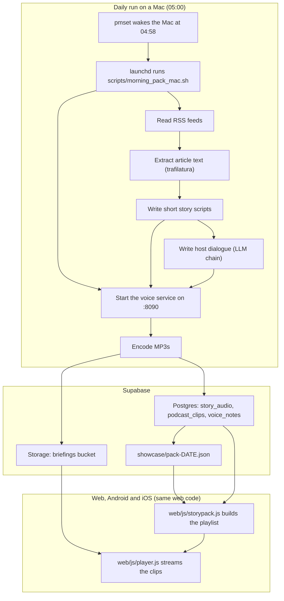

# Technical guide

Hark Daily is a daily news podcast. It turns the day's news into a short episode. A Mac builds the audio once a day. The apps download the clips and assemble a briefing on the device, based on each listener's topics and settings.

## Overview



## Code layout

| Path | What it holds |
| :--- | :--- |
| `app/` | Python pipeline: feeds, scripts, dialogue, packing, upload, reports |
| `voice_service/` | FastAPI text-to-speech service (Chatterbox-Turbo) |
| `web/` | The app. Served by Vercel at hark.vattitude.ca |
| `web/api/` | Vercel functions: share previews, feedback, geo lookup, article fetch |
| `android/`, `ios/` | Capacitor shells that load the hosted web app |
| `scripts/` | Run scripts for macOS, wake scheduling, single-story regeneration |
| `supabase/schema.sql` | Database tables and policies |
| `tests/` | Python tests (pytest) and web tests (`tests/js`, Node test runner) |

## 1. News sources

[`app/topics.py`](../app/topics.py) defines the feeds. Each edition has 8 sections. AI and science are shared, so they are voiced once and used by all three editions.

| Section | Canada (`ca`) | US (`us`) | India (`in`) |
| :--- | :--- | :--- | :--- |
| Top stories | CBC News | New York Times | The Hindu |
| Markets | CBC Business | MarketWatch | Economic Times |
| AI | TechCrunch | TechCrunch | TechCrunch |
| Tech | BetaKit | The Verge | ET Tech |
| Politics | CBC News | NPR | Indian Express |
| Entertainment | CBC News | Variety | Indian Express |
| Science | ScienceDaily (CBC fallback) | same | same |
| Sports | CBC News | CBS Sports | ESPNcricinfo |

US and India section keys have a suffix, for example `top_us` and `markets_in`. Shared sections use plain keys (`ai`, `science`). The pipeline keeps the top 5 stories per section after removing duplicates.

## 2. Scripts and dialogue

- [`app/fetcher.py`](../app/fetcher.py) downloads each article and uses trafilatura to pull out the title, lead image and body text.
- [`app/summarizer.py`](../app/summarizer.py) strips datelines and captions, then picks 2 or 3 key sentences. A script runs about 22 seconds.
- [`app/podcast.py`](../app/podcast.py) writes the two-host dialogue. Matthew gives the facts. Kelly adds the angle or what it means. Each turn is 20 words or fewer. The pieces are:
  - `pod_open_*`, the opening
  - `pod_tease_<section>`, a reaction to the section's top story
  - `pod_bridge_<section>`, the lead-in to a section
  - `pod_close_*`, the sign-off
- Scripts avoid time-of-day phrases like "good morning", so the briefing works at any hour.
- [`app/llm.py`](../app/llm.py) tries the Antigravity CLI first, then Groq, then Gemini. If one fails or hits a rate limit, it moves to the next.

## 3. Voice synthesis

The voice service in [`voice_service/`](../voice_service/README.md) runs Chatterbox-Turbo with PyTorch on Apple Silicon (MPS). The run script starts it before the pack and stops it after.

- Voices are Matthew (`matthew_reference`) and Kelly (`kelly_reference`).
- A full run (3 editions, about 35 stories and 20 dialogue pieces) takes 15 to 20 minutes.
- Long scripts are split at sentence ends and joined at zero crossings, so there are no clicks.
- [`data/lexicon.json`](../data/lexicon.json) fixes pronunciation of names, acronyms and numbers.
- [`app/audio.py`](../app/audio.py) encodes clips as 64 kbps MP3.

Endpoints:

| Method | Path | Returns |
| :--- | :--- | :--- |
| GET | `/health` | Status, device and sample rate |
| GET | `/voices` | Available reference voices |
| POST | `/synthesize?format=mp3` | MP3 bytes. Body is `{"text": "...", "voice": "matthew_reference"}` |

## 4. Fixed voice notes

Greetings, section intros and the sign-off never change, so they are voiced once and kept.

- Storage path is `notes/static/{key}-{voice}.mp3`.
- Database rows use the date `2000-01-01`.
- Each voice has 12 notes: 3 greetings (morning, afternoon, evening), 8 section intros and 1 sign-off.
- `ensure_static_notes()` voices only the notes that are missing. Most days it makes no calls.
- Each day gets pointer rows in `voice_notes` that reference the fixed files.
- `prune_older()` in [`app/pack_ops.py`](../app/pack_ops.py) deletes old days but skips `notes/static/` and the `2000-01-01` rows.

## 5. Storage and database

Audio lives in the Supabase `briefings` bucket:

| Path | Contents |
| :--- | :--- |
| `stories/{date}/` | Story clips |
| `podcast/{date}/` | Dialogue clips |
| `notes/static/` | Fixed voice notes |
| `showcase/pack-{date}.json`, `showcase/pack.json` | Public pack manifest the app loads first |

Main tables in [`supabase/schema.sql`](../supabase/schema.sql):

| Table | Holds |
| :--- | :--- |
| `story_audio` | One row per story clip. Key is `(date, section, rank, voice)` |
| `podcast_clips` | One row per dialogue piece. A `podcast_ready` row marks the day complete |
| `voice_notes` | Greetings, intros and the `pack_ready` marker |
| `profiles` | Signed-in users' settings as JSON |
| `push_subscriptions` | Web push endpoints |
| `app_status`, `run_log` | Run progress and history |

The app only shows a day once its `pack_ready` and `podcast_ready` markers exist, so listeners never get a half-built briefing.

## 6. The app

All three platforms run the code in `web/`. The Android and iOS shells load the hosted site, so a web deploy updates every platform.

### Building the briefing

[`web/js/storypack.js`](../web/js/storypack.js) turns the pack into a playlist:

1. Picks the greeting from the listener's local time.
2. Orders sections by the listener's `section_order`. The default is top, markets, AI, tech, politics, entertainment, science, sports.
3. Takes the wanted number of stories per section. The default is 5 for top stories and 3 for the rest.
4. In podcast mode, adds the dialogue pieces around each section. In full brief mode, adds the fixed section intros instead.
5. Puts a 0.8 second pause between clips.

### Playback

[`web/js/player.js`](../web/js/player.js) plays one clip at a time and preloads the next. It updates the lock screen through the Media Session API. On Android, a native foreground service keeps audio playing with the screen off.

### Weak networks

[`web/js/network.js`](../web/js/network.js) decides whether the connection is fine, slow or offline. The listener only sees real evidence: the browser is offline, playback waited several seconds for data, or two requests timed out within two minutes. `navigator.connection` is only a hint. It stretches timeouts and delays preloading, and never shows a banner, because Chrome's estimate dips on fast Wi-Fi.

- On a slow link, request timeouts are three times longer and the app waits to preload the next clip.
- A short banner says "Slow connection" or "You're offline". In the player it sits in the top bar between the menu and story list buttons.
- A clip that fails to load retries up to 3 times and resumes where it stopped.
- The splash screen tells the user if loading takes more than 4 seconds and offers a retry after 12.

### Offline shell

[`web/sw.js`](../web/sw.js) caches the app shell. Bump the `CACHE` version, and the `?v=` numbers in `index.html`, when you change a cached file.

### Shared stories

Story links look like `/s/{date}/{slug}` or `/?story={section}-{rank}&date={date}`. The app jumps to that story. If the date has aged out, it shows a dialog that offers today's briefing. [`web/api/share.js`](../web/api/share.js) gives link previews to chat apps and social sites.

### Feedback

The feedback form posts to [`web/api/feedback.js`](../web/api/feedback.js), which forwards it to a Discord webhook. It blocks spam with a hidden honeypot field, a simple math question and a 60 second cooldown, and it removes `@everyone` and `@here` mentions.

### Analytics

Google Analytics loads only after the user accepts the consent banner. Events tracked: `share`, `shared_link_open`, `select_content` and `footer_link_click`.

## 7. Daily run

[`docs/nightly.md`](nightly.md) covers scheduling. In short:

- launchd runs `scripts/morning_pack_mac.sh` at 05:00 local time.
- `pmset` wakes the Mac at 04:58, and `caffeinate` keeps it awake during the run.
- When the run ends, `scripts/schedule_wake.sh` sets the next wake.
- The evening run is turned off.

There is also a Docker worker (`python -m app worker`, see `docker-compose.yml`). It runs on a Linux server and handles requests the app queues in Supabase, such as admin rebuilds and account deletions.

## 8. Pre-prod

Pre-prod is a separate Supabase project for testing changes. `scripts/preprod_run.sh` runs packs and checks against it and refuses to run against production. Set `ENV_FILE` to choose a different dotenv file. Vercel preview builds and `localhost` use Pre-prod automatically.

## 9. Configuration

Copy `.env.example` to `.env`. The main settings:

| Variable | Example | Purpose |
| :--- | :--- | :--- |
| `SUPABASE_URL` | `https://xyz.supabase.co` | Supabase project |
| `SUPABASE_SECRET_KEY` | | Service key for uploads |
| `VOICE_SERVICE_URL` | `http://127.0.0.1:8090` | Voice service |
| `VOICE_DIR` | `voice_service/data/voices` | Reference voice clips |
| `STORY_VOICES` | `matthew_reference+kelly_reference` | Voices for story clips |
| `PODCAST_ENABLED` | `true` | Build the two-host dialogue |
| `PODCAST_HOSTS` | `matthew_reference,kelly_reference` | The two hosts |
| `GROQ_API_KEY`, `GEMINI_API_KEY` | | LLM fallbacks |
| `BRIEFING_TIMEZONE` | `America/Toronto` | Timezone for the schedule |
| `VAPID_PUBLIC_KEY`, `VAPID_PRIVATE_KEY` | | Web push |

## 10. Commands

```bash
python -m app pack --edition ca,us,in     # build today's pack
python -m app pack --check                # show what today's pack has
python -m app pack --podcast-only --force # redo the dialogue only
python -m app pack --showcase-only        # republish the public manifest
python scripts/regen_story.py --date 2026-11-10 --section markets --rank 1
./scripts/schedule_wake.sh status         # show the next wake
```

## 11. Tests

```bash
npm test                                  # web app
.venv/bin/python -m pytest -q tests       # pipeline
cd android && ./gradlew testDebugUnitTest # Android shell
```

GitHub Actions runs the web and Python tests on every pull request.
